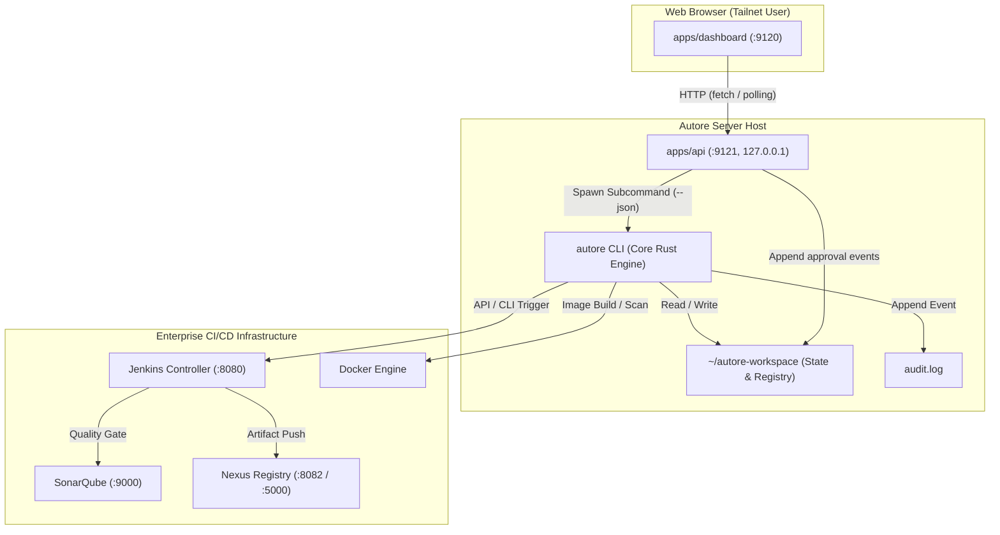

# Autore Architecture Guide

This document describes the architectural principles, component responsibilities, data flow, and security boundaries of the Autore DevSecOps Platform.

---

## 1. Architectural Philosophy: Explicit Component Boundaries

Autore separates host operations, release workflow, and presentation:
- **Rust CLI (`autore`):** Owns host-oriented operations such as project scaffolding, scans, deployment orchestration, workspace state, and Jenkins integrations. The API invokes CLI commands for Jenkins job registration and triggers; credentials stay in the CLI.
- **Hono API (`apps/api`):** Authenticates sessions, reads current roles from the allowlist, rate-limits mutations, enforces approval/promote/rollback rules, appends approval events to the release ledger, and invokes the CLI for release jobs. This API layer therefore owns release-workflow rules; it is not a zero-side-effect proxy.
- **Next.js dashboard (`apps/dashboard`):** Presents status and actions, and calls the API. It does not directly manipulate Docker, Git repositories, or Jenkins.

Persistent operational state is file-backed in the workspace and is not held only in service memory. The API binds to loopback; production dashboard binds to the host's Tailscale address.

---

## 2. Component Boundaries and Responsibilities

| Component | Technology | Network Binding | Primary Responsibilities |
|---|---|---|---|
| `cli/` | Rust (Edition 2021) | Native process | Authoritative orchestrator for project bootstrapping, pre-commit hook enforcement, port allocation, static security scanning, Jenkins job management, and workspace status reporting. |
| `web/packages/contracts` | TypeScript (source-only) | In-process | Single source of truth for contract types and fail-closed runtime payload validators (`parseApiResponse`, `validateSbomPayload`, `isDashboardStatus`, `validateDashboardStatus`, `validateRuns`, `validateActive`). |
| `web/apps/api` | Hono / Node.js `>=22.12.0` | `127.0.0.1:9121` | Authenticates sessions, reads the role allowlist, rate-limits actions, serves REST endpoints, enforces release approval/promote/rollback rules, appends approval events, and invokes CLI for host/Jenkins operations. |
| `web/apps/dashboard` | Next.js 15 / React 19 / Tailwind | Dev: `0.0.0.0:9120`; production: host Tailscale IPv4 `:9120` | Responsive operator UI. Calls `/api/*`, validates payloads with `@autore/contracts`, and renders status, pipelines, releases, SBOMs, and actions. |
| `vars/autorePipeline.groovy` | Jenkins Shared Library | Jenkins agent | Fail-closed CI/CD pipeline (stages 1–10 plus the 5.5 E2E gate) enforcing secret scanning, unit and browser tests, SonarQube quality gate, CVE scanning, CycloneDX SBOM generation, checksum verification, Nexus digest pinning, and deployment. |
| `scripts/` & `/usr/local/lib/autore-ci/` | POSIX Shell | Runner filesystem | Trusted out-of-repo execution gates for web quality checks, SonarQube scans, and digest verification. |

---

## 3. Data Flow Architecture

### 3.1 Read Flow (`GET /api/*`)

1. Dashboard requests status, history, active builds, SBOM, and releases from Hono API.
2. API invokes the Rust CLI for host/Jenkins-backed data such as dashboard status, run history, active builds, and SBOM artifacts.
3. `GET /api/releases?app=<app>` reads the file-backed `release-state.json`, folds release events using `@autore/contracts`, and returns the derived release/deployment/environment view. A missing `app` is `400`; a ledger read/fold error is `502`.
4. Dashboard validates payloads with fail-closed validators from `@autore/contracts` before updating UI state.

### 3.2 Standard Action Flow (`POST /api/actions/*`)

1. Dashboard submits a deploy, scan, or quick-start action with explicit inputs.
2. Hono verifies session and current allowlist role, validates the request, rate-limits it, and records audit context.
3. API runs the corresponding Rust CLI command with `AUTORE_PROGRESS=json` and reads the CLI's JSON lines as it works. The CLI performs host operations and Jenkins interactions; credentials remain in CLI configuration.
4. The API returns the final result for that request. The dashboard does not hold an event stream open; it polls (5 s while a pipeline is active, 15 s when idle) and stops polling when the tab is hidden.

### 3.3 Release Workflow (`POST /api/releases/*`)

1. `approve` and `reject` require role `qa`; rejection requires non-empty `alasan`. API appends decision events to `release-state.json`. Endpoints are `POST /api/releases/:id/approve`, `/reject`, `/promote`, and `/rollback`, and each handler re-reads the caller's role from the allowlist.
2. `promote` requires role `admin`, release status `disetujui`, staging's active deployment digest to match the release, and a different promoter from approver. API asks CLI to trigger `<app>-promote`; job deploys by digest without rebuilding.
3. `rollback` requires an explicit `environment`. Staging requires role `qa`; production requires `admin`. API selects latest healthy non-active deployment, then asks CLI to trigger `<app>-rollback` by digest.
4. CLI owns Jenkins credentials and job triggers. Jenkins promote/rollback jobs use canonical Jenkinsfiles from Autore `main`; the release ledger records deployment outcomes.

## 4. Security Invariants and Network Isolation

1. **Loopback API Binding:** `apps/api` binds exclusively to `127.0.0.1:9121`.
2. **Dashboard Binding:** Development command binds `0.0.0.0:9120` for local framework access; production `next start` binds the host Tailscale IPv4 address (`<tailscale-ip>:9120`). Production deployment must not expose the dev server command.
3. **Fail-Closed Type Contracts:** `@autore/contracts` rejects malformed, unknown, or truncated payloads. Dashboard components never cast API responses blindly.
4. **Trusted Runner Execution:** The Jenkins pipeline (`vars/autorePipeline.groovy`) executes security gates from trusted system paths (`/usr/local/lib/autore-ci/`).
5. **Static Byte Guard & Native Gitleaks:** The pre-commit hook (`cli/src/hooks.rs`) executes byte-level regex inspection and native `gitleaks protect --staged` before any commit is accepted into version control.
