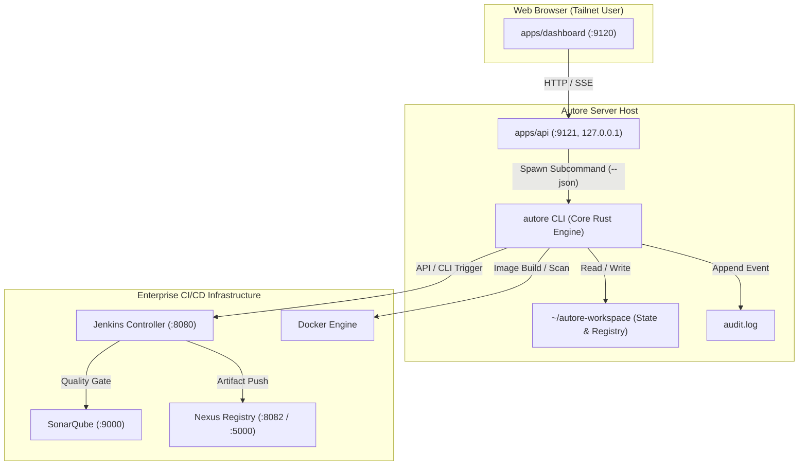

# Autore Architecture Guide

This document describes the architectural principles, component responsibilities, data flow, and security boundaries of the Autore DevSecOps Platform.

---

## 1. Architectural Philosophy: "CLI as the Brain, Web as the Interface"

Autore is engineered around a strict separation of concerns:
- **CLI as the Brain:** The core Rust binary (`autore`) is the sole authoritative engine for business logic, infrastructure operations, process execution, security scans, filesystem workspace management, and CI/CD coordination.
- **Web as the Interface:** The web layer consists of a Next.js frontend (`apps/dashboard`) and a lightweight Hono API gateway (`apps/api`). The web layer contains **zero direct infrastructure side-effects**: it does not invoke Docker directly, it does not manipulate Git repositories directly, and it does not make direct mutation calls to Jenkins or Nexus. All infrastructure actions are delegated to the CLI.

---

## 2. Component Boundaries and Responsibilities

| Component | Technology | Network Binding | Primary Responsibilities |
|---|---|---|---|
| `cli/` | Rust (Edition 2021) | Native process | Authoritative orchestrator for project bootstrapping, pre-commit hook enforcement, port allocation, static security scanning, Jenkins job management, and workspace status reporting. |
| `web/packages/contracts` | TypeScript (source-only) | In-process | Single source of truth for contract types and fail-closed runtime payload validators (`parseApiResponse`, `validateSbomPayload`, `isDashboardStatus`, `validateDashboardStatus`, `validateRuns`, `validateActive`). |
| `web/apps/api` | Hono / Node.js 20+ | `127.0.0.1:9121` (Loopback only) | Stateless REST API and SSE streaming bridge. Translates HTTP requests into `autore <subcommand> --json` process calls, enforces rate limits and authentication, and writes immutable audit logs. |
| `web/apps/dashboard` | Next.js 15 / React 19 / Tailwind | `<tailscale-ip>:9120` | Responsive web user interface. Consumes `/api/*`, validates all incoming payloads with `@autore/contracts`, and renders system status, pipelines, SBOMs, and project actions. |
| `vars/autorePipeline.groovy` | Jenkins Shared Library | Jenkins agent | 10-stage fail-closed CI/CD pipeline enforcing secret scanning, unit testing, SonarQube quality gate, CVE scanning, CycloneDX SBOM generation, checksum verification, Nexus digest pinning, and deployment. |
| `scripts/` & `/usr/local/lib/autore-ci/` | POSIX Shell | Runner filesystem | Trusted out-of-repo execution gates for web quality checks, SonarQube scans, and digest verification. |

---

## 3. Data Flow Architecture

### 3.1 Read Flow (`GET /api/*`)

1. User requests dashboard views (`/`, `/pipelines`, `/runs`, `/security`).
2. Dashboard fetches corresponding endpoints on API (`GET /api/status`, `GET /api/runs`, `GET /api/active`, `GET /api/sbom/:app`).
3. Hono API spawns the corresponding CLI subcommand with the `--json` flag:
   - `autore status --json` reads `~/autore-workspace/dashboard-status.json` and `registry.tsv`.
   - `autore runs --json` fetches and formats completed pipeline history from Jenkins.
   - `autore active --json` inspects running and queued Jenkins builds.
   - `autore sbom <app> --json` parses and filters CycloneDX SBOM artifacts.
4. CLI emits canonical JSON to `stdout`.
5. Hono API passes the JSON response back to the dashboard with appropriate HTTP headers.
6. Dashboard validates the response payload with fail-closed validators from `@autore/contracts` before updating UI state. If validation fails, UI displays a clear error state rather than crashing or displaying corrupt data.

### 3.2 Write Flow (`POST /api/actions/*`)

1. User submits an action (e.g., Quick-Start project creation or manual pipeline rerun).
2. Dashboard sends a `POST` request to `apps/api`.
3. Hono API validates input parameters, appends an immutable entry to `audit.log`, and spawns the CLI:
   - `autore quick-start --app-name <name> --deploy-port <port> ...`
   - `autore deploy <app>`
   - `autore scan <path>`
4. CLI runs with `AUTORE_PROGRESS=json`. It emits real-time progress markers (`@@AUTORE {"tahap":"...","status":"...","pesan":"..."}`) to `stdout`.
5. Hono API streams these markers to the browser via Server-Sent Events (SSE) `/api/events/pipeline`.
6. Dashboard visualizes live step transitions in real time.
7. Upon completion, CLI updates `~/autore-workspace/dashboard-status.json` and exits.

---

## 4. Security Invariants and Network Isolation

1. **Loopback API Binding:** `apps/api` binds exclusively to `127.0.0.1:9121`. It is strictly prohibited from binding to `0.0.0.0` or external network interfaces.
2. **Tailnet Dashboard Access:** `apps/dashboard` binds exclusively to the host Tailscale IPv4 address (`<tailscale-ip>:9120`, e.g. `100.80.3.14:9120`). Access requires authenticated tailnet membership.
3. **Fail-Closed Type Contracts:** `@autore/contracts` rejects malformed, unknown, or truncated payloads. Dashboard components never cast API responses blindly.
4. **Trusted Runner Execution:** The Jenkins pipeline (`vars/autorePipeline.groovy`) executes security gates from trusted system paths (`/usr/local/lib/autore-ci/`). Target repositories are untrusted and cannot override gate criteria.
5. **Static Byte Guard & Native Gitleaks:** The pre-commit hook (`cli/src/hooks.rs`) executes byte-level regex inspection and native `gitleaks protect --staged` before any commit is accepted into version control.
