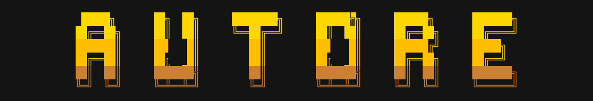
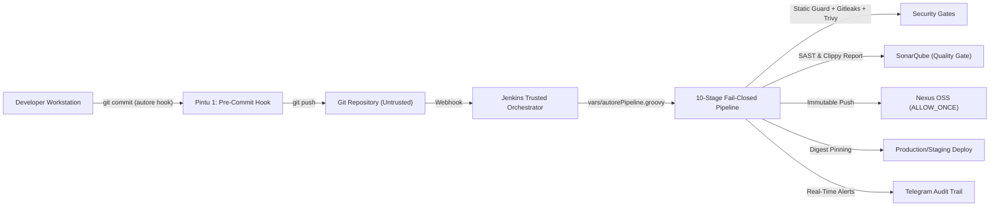

<p align="center">
  
</p>

# Autore 🛡️
<p align="center">
  <a href="#quick-start">Quick Start</a> • <a href="#arsitektur-utama">Arsitektur Utama</a> • <a href="#cli-reference-autore">CLI Reference</a> • <a href="#enterprise-cicd-pipeline-10-tahap-fail-closed">CI/CD Pipeline</a> • <a href="#lingkungan-sandbox--testing">Sandbox Guide</a>
</p>
<p align="center">
  
  
  
  
  
  
</p>

**Platform CI/CD terstandarisasi dan CLI developer tool berbasis Rust berkinerja tinggi untuk PT Tugu Reasuransi Indonesia.** Autore mengintegrasikan alur kerja lokal developer, pencegahan keamanan *fail-closed*, pengerasan container, verifikasi SonarQube SAST, penyimpanan artifact immutable Nexus, serta pelaporan audit deterministik ke Telegram ke dalam satu ekosistem CI/CD enterprise.

<table>
<tr><td><b>Fail-Closed Security Gates</b></td><td>Pertahanan berlapis pra-build dan pasca-build: Static Byte Guard native, deteksi kebocoran kredensial Gitleaks, serta pemindaian CVE filesystem & image via Trivy (container terisolasi, digest ter-pin).</td></tr>
<tr><td><b>Native Rust CLI Engine (<code>autore</code>)</b></td><td>Binary hasil kompilasi Rust mandiri tanpa dependensi runtime eksternal. Eksekusi sub-detik untuk penegakan git pre-commit, templating proyek, dan diagnostik runner.</td></tr>
<tr><td><b>Admin-Controlled CI/CD Orchestrator</b></td><td>Jenkins Trusted Shared Library otoritatif dengan 10 tahapan fail-closed, immutabilitas git commit SHA 40-hex penuh, dan SonarQube Quality Gate dengan verifikasi metrik bahasa Rust.</td></tr>
<tr><td><b>Immutable Registry & Artifact Store</b></td><td>Penyimpanan container Docker & binary release di Sonatype Nexus OSS dengan kebijakan <code>ALLOW_ONCE</code> (Disable redeploy), pembuatan SBOM CycloneDX, dan verifikasi digest <code>HEAD</code> terotentikasi.</td></tr>
<tr><td><b>Automated Real-Time Audit Trail</b></td><td>Notifikasi audit deterministik ke Bot Telegram untuk setiap event build (baik SUKSES maupun DITOLAK), mencatat commit SHA, pembuat perubahan, branch, build ID, dan detail pelanggaran keamanan.</td></tr>
</table>

---

## Quick Start

## Catatan Uji   
    Percobaan Poll SCM otomatis — build harus jalan sendiri tanpa klik Build Now. 

### 1. Kompilasi & Instalasi CLI `autore` dari Source

```bash
# Kompilasi binary release berbasis Rust
cargo build --release --manifest-path cli/Cargo.toml

# Pasang binary global (butuh akses sudo/root)
sudo cp cli/target/release/autore /usr/local/bin/autore
sudo chmod 0755 /usr/local/bin/autore

# Verifikasi instalasi
autore --help
```

### 2. Perintah Cepat Harian Developer

```bash
# Periksa kesehatan lingkungan runner & perkakas sistem
autore doctor

# Pasang Satpam Pintu 1 (Git Pre-Commit Hook otomatis)
autore hook install

# Pindai keamanan lokal pra-commit tanpa docker (<1 detik)
autore scan --no-docker --path .

# Generate scaffolding standar (Dockerfile, Jenkinsfile, .dockerignore)
autore init
```

---

## Arsitektur Utama

Autore dirancang dengan prinsip **pemisahan tegas** antara orchestrator yang dikontrol admin dan repositori aplikasi yang diperlakukan sebagai *untrusted input*:



1. **Dedicated Jenkins Runner (`runner/`)**
   - Memisahkan beban *build* dan eksekusi container dari Jenkins Controller (Controller dikonfigurasi dengan `0` executor).
   - Berjalan sebagai service systemd (`jenkins-agent.service`) dengan koneksi WebSocket terisolasi.
2. **Native Rust Developer CLI (`cli/`)**
   - Binary native tanpa dependensi runtime interpreter (Python/Node).
   - Eksekusi instan untuk standarisasi proyek, pemindaian statis, dan diagnostik sistem.
3. **Admin-Controlled Jenkins Shared Library (`vars/` di root repo)**
   - Pipeline CI/CD otoritatif (`vars/autorePipeline.groovy`) berada di repositori admin, bukan di repositori aplikasi.
   - Menghalangi modifikasi tidak sah terhadap gerbang pengujian dan kebijakan deployment.
4. **SonarQube SAST & Quality Gate (`scripts/ci-sonarqube-gate.sh`)**
   - Mengintegrasikan hasil Clippy eksternal (`-Dsonar.rust.clippy.enabled=false`) tanpa eksekusi duplikat.
   - Memvalidasi status Quality Gate berbasis `analysisId` serta memastikan metrik analisis Rust (`ncloc_language_distribution`) terverifikasi.
5. **Nexus Artifact & Container Registry (`scripts/ci-nexus-publish.sh`)**
   - Kebijakan penulisan `ALLOW_ONCE` (*Disable redeploy*) mencegah penimpaan tag container atau file binary yang sudah ada.
   - Pengecekan digest via HTTP `HEAD` terotentikasi ke endpoint manifest Docker registry.
6. **Pelaporan Audit Telegram Otomatis (`scripts/notify-telegram.sh`)**
   - Mengirim ringkasan lengkap untuk build yang berhasil maupun yang diblokir oleh sistem keamanan.

---

## CLI Reference (`autore`)

CLI `autore` menyediakan perintah modular untuk mendukung siklus hidup pengembangan DevSecOps:

| Perintah | Deskripsi | Mode Operasi |
| :--- | :--- | :--- |
| `autore init` | Membuat `Dockerfile`, `Jenkinsfile`, dan `.dockerignore` standar untuk Python, Node.js, Java, atau Go dengan proteksi *no-clobber* (`--force` untuk menimpa). | Interaktif / Non-interaktif |
| `autore scan` | Menjalankan Static Byte Guard native + Gitleaks secret scanner + Trivy vulnerability & misconfig scanner pada filesystem proyek. | Authoritative (Full) / `--no-docker` (Pre-commit) |
| `autore scan-image` | Memindai image container pasca-build: verifikasi UID non-root, pemindaian CVE (`HIGH,CRITICAL`), dan ekspor SBOM CycloneDX (`sbom.cdx.json`). | Container Image Scan |
| `autore hook install` | Memasang script pre-commit hook otomatis di `.git/hooks/pre-commit`, mem-backup hook yang sudah ada dan merangkainya (*chaining*). | Git Integration |
| `autore doctor` | Mendiagnosis kesiapan sistem: ketersediaan Git, Java 21, Docker, Docker Compose, service systemd runner, izin binary `/usr/local/bin/autore`, dan kapasitas penyimpanan. | System Diagnostics |

### Contoh Penggunaan CLI

```bash
# 1. Scaffolding aplikasi baru
autore init --lang python --name my-service

# 2. Pemindaian pra-commit lokal (cepat, tanpa kontainer)
autore scan --no-docker --path .

# 3. Pemindaian pra-build penuh pada CI
autore scan --path .

# 4. Pemindaian image container pasca-build
autore scan-image --image 127.0.0.1:5000/my-service:build-1-commit-e77d5049f8a12b3c4d5e6f708192a3b4c5d6e7f8 \
  --severity HIGH,CRITICAL \
  --sbom-output dist/sbom.cdx.json
```

---

## Enterprise CI/CD Pipeline (10 Tahap Fail-Closed)

Pipeline `autorePipeline.groovy` menjalankan 10 tahapan fail-closed secara sekuensial. Jika salah satu tahapan gagal, seluruh pipeline langsung berhenti (*abort*) dan memicu notifikasi audit:

```text
[1. Checkout & Audit Metadata] (Tag 40-hex commit SHA, tolak SHORT_SHA / latest)
               │
               ▼
[2. Autore Static Guard + Gitleaks] (Static checks + deteksi secret kredensial)
               │
               ▼
[3. Trivy Source & Config Scan] (SCA lockfile & validasi Dockerfile, HIGH/CRITICAL)
               │
               ▼
[4. Clippy + SonarQube SAST] (Ekspor clippy-report.json & sonar-scanner CLI)
               │
               ▼
[5. SonarQube Quality Gate] (Poll CE task -> validasi analysisId & ncloc Rust)
               │
               ▼
[6. Build Container & musl Binary] (Docker build immutable tag + Rust musl)
               │
               ▼
[7. Trivy Final Image Scan] (Verifikasi non-root UID + CVE container HIGH/CRITICAL)
               │
               ▼
[8. Generate SBOM & Checksums] (CycloneDX JSON + SHA256SUMS)
               │
               ▼
[9. Push Nexus & Verify Digest] (ALLOW_ONCE repositori + authenticated HEAD digest)
               │
               ▼
[10. Deploy by @sha256:<digest>] (Deploy zero-downtime berbasis digest SHA-256)
               │
               ▼
[Post-Always: Telegram Audit & Cleanup] (Notifikasi deterministik + pembersihan)
```

---

## Lingkungan Sandbox & Testing

Repositori ini menyediakan modul pengujian lokal mandiri di direktori `sandbox/services/`:

### 1. Inisialisasi Layanan Lokal (SonarQube & Nexus)

Skrip bootstrap mengotomatisasi seluruh persiapan lokal secara idempoten:

```bash
./sandbox/services/bootstrap-local-services.sh
```

Skrip di atas secara otomatis:
- Mengekstrak `cacerts` dari image SonarQube dan menghapus sertifikat root CA eMudhra (`emSign`) yang terdampak advisory keamanan SonarSource.
- Menjalankan container SonarQube Community (`127.0.0.1:9000`) dan Sonatype Nexus OSS (`127.0.0.1:8082` & Docker port `5000`).
- Menyetujui EULA Nexus 3.96 Community Edition melalui REST API.
- Membuat repositori `docker-hosted` (port `5000`) dan `autore-releases` (raw) dengan kebijakan `ALLOW_ONCE` (*Disable redeploy*).
- Menonaktifkan *Anonymous Access* agar login Docker CLI menerima challenge `401 WWW-Authenticate`.

### 2. Menjalankan Unit & Integration Tests

```bash
# Jalankan test suite Python
python3 -m unittest sandbox/dummy-app/test_security_check.py

# Jalankan test suite CLI Rust
cargo test --manifest-path cli/Cargo.toml
```

---

## Struktur Repositori

```text
Autore/
├── assets/                     # Visual branding (banner, badges)
│   └── banner.png
├── cli/                        # Source code CLI Rust (autore)
│   ├── Cargo.toml
│   └── src/
├── vars/                       # Jenkins Trusted Shared Library (Admin-controlled)
│   ├── vars/autorePipeline.groovy
│   └── README.md
├── runner/                     # Provisioning & systemd service Jenkins Agent
│   ├── setup-agent.sh
│   ├── install-agent-service.sh
│   └── jenkins-agent.service
├── scripts/                    # Skrip DevSecOps Gate, Publish, Deploy, & Telegram
│   ├── ci-sonarqube-gate.sh
│   ├── ci-nexus-publish.sh
│   ├── ci-deploy-by-digest.sh
│   ├── build-musl-release.sh
│   ├── security-check.sh
│   └── notify-telegram.sh
├── sandbox/                    # Lingkungan uji coba sandbox & dummy application
│   ├── services/               # Docker Compose SonarQube & Nexus + bootstrap
│   ├── jenkins/                # Docker Compose Jenkins Controller
│   └── dummy-app/              # Sample app & automated integration tests
└── docs/                       # Desain arsitektur, spesifikasi, dan audit keamanan
    ├── PRODUCTION-ISOLATION-DESIGN.md
    └── superpowers/specs/
```

---

## Peringatan Keamanan Sandbox (C-1, C-2, & H-6)

> [!WARNING]
> **STATUS ARSITEKTUR SANDBOX / POC VALIDATION:**
> Konfigurasi runner (`runner/setup-agent.sh`) dan controller (`sandbox/jenkins/docker-compose.yml`) di repositori ini adalah **lingkungan uji coba (Sandbox)** dan **BELUM berstatus production-ready**:
> 1. **C-1 (Keanggotaan Grup `docker` di Host):** User `jenkins` pada sandbox runner berada di dalam grup `docker` host (setara dengan akses `root`). Jangan menaruh kredensial produksi dan jangan menjalankan PR dari sumber luar yang tidak dipercaya. Untuk produksi kantor, runner wajib menggunakan container ephemeral + rootless builder sesuai [`docs/PRODUCTION-ISOLATION-DESIGN.md`](docs/PRODUCTION-ISOLATION-DESIGN.md).
> 2. **C-2 (Pipeline Otoritatif):** Pipeline build wajib dijalankan melalui *Jenkins Trusted Shared Library* yang dikontrol admin (`vars/autorePipeline.groovy`), bukan dari skrip yang dapat dimodifikasi oleh pembuat PR di repositori aplikasi.
> 3. **H-6 (Loopback Binding):** Controller Jenkins diikat ke `127.0.0.1:8080`. Akses web dari workstation developer wajib menggunakan secure SSH tunneling (`ssh -L 8080:127.0.0.1:8080 user@vps`).
