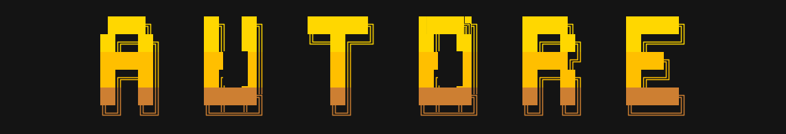
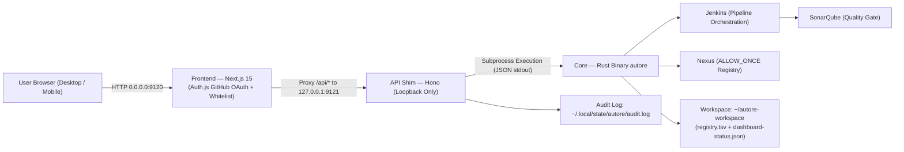

<p align="center">
  
</p>

<h1 align="center">Autore - Automation Tugure</h1>

<h3 align="center">CLI as the Brain, Web as the Interface</h3>

<p align="center">
  
  
  
  
  
  
</p>

<p align="center">
  <b>Standardized DevSecOps CI/CD Platform for PT Tugu Reasuransi Indonesia</b><br/>
  All operational logic resides exclusively in a standalone Rust binary (<code>autore</code>). The web dashboard acts strictly as a presentation and interaction layer, executing commands via subprocess and never duplicating business logic.
</p>

---

## Overview

Autore is an enterprise DevSecOps automation platform developed for PT Tugu Reasuransi Indonesia. Designed around the architectural invariant **"CLI as the Brain, Web as the Interface"**, all domain rules, pipeline configurations, scaffolding generators, and security gates are compiled directly into the Rust CLI.

The web interface is a stateless presentation layer built on Next.js and Hono that delegates every user action to the underlying binary. If the web services are restarted, terminated, or replaced, no operational state is lost because the filesystem and the CLI remain the single source of truth.

---

## Key Features

- **Real-Time Dashboard**: Features smart adaptive polling (5 seconds during active pipeline execution, 15 seconds during idle states) paired with a Page Visibility Guard that halts background network activity when tabs are minimized or hidden. Built-in API response caching (5-second TTL) shields local services from excessive polling.
- **1-Click Quick Start**: Complete application onboarding executed directly from the web interface. Generates standardized source code scaffolding, creates remote GitHub repositories, registers automated Jenkins multibranch jobs, and triggers the initial build in a single operation.
- **Multi-Language Support**: Production-ready scaffolding templates for **Python** (3.12-slim, non-root user), **Node.js** (20-alpine, unprivileged user), **Java** (Maven multi-stage build, Eclipse Temurin 21 JRE), and **Go** (minimal scratch/distroless static binary). Each template includes automated build tests and dedicated host port allocation to prevent deployment collisions.
- **SBOM Viewer**: Integrated Software Supply Chain Security dashboard rendering CycloneDX v1.5 JSON components directly from build artifacts, complete with package type classification, version tracking, license compliance inspection, and instant search filtering.
- **Audit Trail & Identity Propagation**: Immutable audit logging recorded in structured JSONL format (`~/.local/state/autore/audit.log`). Authenticated GitHub user sessions are propagated directly to CLI subprocess arguments, attributing Git commit author metadata (`user.name`, `user.email`) to the active developer rather than an untraceable bot.
- **Fail-Closed Security Pipeline**: Strict 9-stage pipeline managed through an admin-governed Jenkins Trusted Shared Library. Any scanner failure, misconfiguration, or unverified artifact immediately terminates the build with zero bypasses.
- **Responsive Operational UI**: Clean, light-only interface optimized for both desktop operations and mobile devices, featuring a mobile bottom navigation bar, live Lead Time analytics, stage matrix inspection, and real-time connection status indicators.

---

## Architecture



### Architectural Layers

| Layer | Technology | Operational Responsibility |
|---|---|---|
| **Frontend** | Next.js 15 (App Router), React 19, Tailwind CSS, Lucide | Operational dashboard, pipeline visualization, SBOM catalog, Lead Time metric cards, and authenticated action dispatching. Light-mode operational tokens with complete mobile responsiveness. |
| **API Shim** | Hono (Node.js), Auth.js (NextAuth v5 JWT) | GitHub OAuth authentication, case-insensitive whitelist authorization, action argument validation, subprocess invocation, and JSONL audit trail logging. Strictly bound to loopback `127.0.0.1:9121`. |
| **Core** | Rust (2021 Edition, musl static binary) | Sole owner of all business logic: scaffolding (`init`, `quick-start`), artifact scanning (`scan`, `scan-image`), deployment orchestration (`deploy`), health inspections (`doctor`), and systemd unit supervision. |
| **Integrations** | Jenkins Trusted Shared Library, Nexus OSS 3, SonarQube, Trivy, Gitleaks | Authoritative pipeline execution, immutable artifact storage, SAST quality gates, secret leak prevention, and vulnerability analysis. |
| **State** | `~/.config/autore/`, `~/.local/state/autore/`, `~/autore-workspace/` | File-backed operational state. Eliminates in-memory session loss upon process restarts. |

### Architectural Invariants

1. **Zero Business Logic in Frontend**: The web dashboard does not calculate pipeline states, parse raw scanner findings, or manage deployment logic. All operations translate directly into CLI subcommands.
2. **Loopback API Isolation**: The Hono API listens exclusively on `127.0.0.1:9121`. Only the Next.js frontend is network-facing (`0.0.0.0:9120`), ensuring all external access is authenticated through GitHub OAuth before reaching the API layer.
3. **Fail-Closed Execution**: Security scanners and gates never fail silently. Missing tools, network timeouts, or non-zero scanner exit codes halt the pipeline immediately.

---

## 9-Stage Fail-Closed Security Pipeline

The authoritative CI/CD pipeline definition is maintained in the administrative repository (`vars/autorePipeline.groovy`). Application repositories cannot weaken or alter gate thresholds.

| Stage | Gate Name | Security Checks & Enforcement |
|---|---|---|
| 1 | **Checkout & Audit Metadata** | Verifies full 40-character hexadecimal commit SHA (rejects mutable tags or short SHAs); initializes audit metadata. |
| 2 | **Static Guard & Gitleaks** | Native byte guard checks forbidden patterns; Gitleaks scans entire commit history for credentials and secrets. |
| 3 | **Trivy Source & Config Scan** | Software Composition Analysis (SCA) for dependencies and Dockerfile misconfigurations; blocks HIGH and CRITICAL vulnerabilities. |
| 4 | **Clippy & SonarQube SAST** | Enforces static code quality and SAST standards via SonarQube Quality Gate. |
| 5 | **Image & Musl Binary Build** | Generates reproducible container image with immutable tags and compiles standalone static musl binaries. |
| 6 | **Trivy Image Scan & SBOM** | Enforces non-root container UID policies; scans final container filesystem for CVEs; exports CycloneDX SBOM JSON. |
| 7 | **Verify Checksums** | Validates SHA-256 cryptographic signatures against release artifacts. |
| 8 | **Push to Nexus Registry** | Uploads image to private Nexus repository under `ALLOW_ONCE` immutability policy (disallows tag overwriting). |
| 9 | **Deploy by Verified Digest** | Deploys containers strictly referencing `@sha256:<digest>` verified in Stage 8, preventing image spoofing. |

---

## Tech Stack

- **Core CLI**: Rust (2021 edition), Musl static binary target, zero runtime dependencies.
- **Web Frontend**: Next.js 15 (App Router), React 19, Tailwind CSS, Lucide React icons.
- **API Shim**: Hono, Auth.js v5 (NextAuth), Node.js LTS.
- **Continuous Integration**: Jenkins LTS with Trusted Shared Library.
- **Artifact & Container Registry**: Sonatype Nexus OSS 3 (`ALLOW_ONCE` immutable policy).
- **Security & Quality**: Trivy (SCA, Container, Config), Gitleaks, SonarQube Community Edition.
- **Standards & Specifications**: CycloneDX v1.5 JSON (SBOM), SPDX licenses, JSONL (Audit logging).
- **Service Supervision**: systemd user services (`autore-web-api.service`, `autore-web-dashboard.service`).

---

## Quick Start

### Prerequisites

- Rust toolchain (Cargo 1.85+)
- Node.js (v18.0.0 or higher) and npm
- Docker Engine (v24.0 or higher)
- Git

### 1. Installation

#### Automated One-Line Installer (Linux / macOS)

```bash
curl -fsSL https://raw.githubusercontent.com/tugure-git-intern/Autore/main/install.sh | bash
```

*Windows PowerShell:*
```powershell
irm https://raw.githubusercontent.com/tugure-git-intern/Autore/main/install.ps1 | iex
```

#### Manual Build from Source

```bash
git clone https://github.com/tugure-git-intern/Autore.git
cd Autore

# Build Core Rust CLI
cargo build --release --manifest-path cli/Cargo.toml
install -m755 cli/target/release/autore ~/.local/bin/autore

# Install Web Dashboard & API Dependencies
cd web
cp .env.example .env
npm install
```

### 2. Configure Environment

Configure OAuth credentials and operator access controls in `web/.env`:

- `GITHUB_ID`: GitHub OAuth Application Client ID
- `GITHUB_SECRET`: GitHub OAuth Application Client Secret
- `NEXTAUTH_SECRET`: Cryptographic secret key used for session encryption
- `NEXTAUTH_URL`: Canonical dashboard address (e.g., http://localhost:9120)
- `AUTORE_ALLOWED_USERS`: Comma-separated list of authorized GitHub logins (e.g., user1,user2)

*Note: GitHub logins are evaluated case-insensitively. Authorized access can alternatively be configured via `web/allowed-users.json`.*

### 3. Launch Services

Start the background operational services:

```bash
autore start
```

Or run interactively via the CLI launcher:

```bash
autore
```

The interactive menu enables service status checks, log streaming, and diagnostic inspection:

```text
Select task:
  [1] Web Dashboard   - Start services, verify health, print URL
  [2] TUI Legacy      - Fullscreen terminal user interface
  [3] Exit
  [4] Admin           - Service controls (Start / Stop / Restart / Logs)
```

Access the dashboard at `http://localhost:9120` (or through your assigned host/Tailscale IP).

---

## CLI Command Reference

| Command | Alias | Description |
|---|---|---|
| `autore` | — | Interactive launcher menu (Web Dashboard / TUI / Admin). In non-TTY environments, prints quick help. |
| `autore status` | `st` | Prints live system status, infrastructure health, and latest pipeline record. |
| `autore runs` | — | Retrieves 7-day Jenkins pipeline run history. |
| `autore active` | — | Lists actively running or queued pipeline jobs. |
| `autore deploy` | `dep` | Registers application project to Jenkins CI/CD and triggers automated build. |
| `autore quick-start` | `qs` | 1-Click workflow: scaffolds code, creates GitHub repository, configures Jenkins, and runs build. |
| `autore init` | `in` | Generates standardized `Dockerfile`, `Jenkinsfile`, and `.dockerignore` for python, nodejs, java, or go. |
| `autore doctor` | `doc` | Diagnoses health of Runner, Docker daemon, Java runtime, and Jenkins connection. |
| `autore scan` | — | Pre-build security scan: Static Byte Guard + Gitleaks + Trivy. Supports `--no-docker` fast mode. |
| `autore scan-image` | — | Post-build container scan: verifies non-root execution, scans CVEs, and exports CycloneDX SBOM. |
| `autore hook install` | — | Installs the local Git pre-commit gate: static guard + native Gitleaks on staged files (no Docker). |
| `autore sbom` | — | Inspects software supply chain dependencies from build CycloneDX SBOM artifacts. |
| `autore start / stop / restart` | — | Controls background services via systemd user manager. |
| `autore logs` | — | Streams real-time operational logs from dashboard and API services (`--lines N`, `--no-follow`). |
| `autore update` | — | Downloads and atomicity verifies the latest binary release from GitHub Releases. |

```bash
# Example usages
autore st
autore init --app-name claims-service --stack python --app-port 8000 --deploy-port 8083
autore scan --no-docker --path .
autore scan-image --image 127.0.0.1:5000/claims-service:build-10 --severity HIGH,CRITICAL --sbom-output dist/sbom.cdx.json
autore logs --lines 50 --no-follow
```

### Pre-commit security gate

`autore hook install` writes `.git/hooks/pre-commit` with two layers that run before every commit:

| Layer | Tool | Scope | Typical cost |
|---|---|---|---|
| Static guard | `autore scan --no-docker` | whole working tree | ~40 ms |
| Secret detection | native `gitleaks` (`git --staged`) | staged files only | ~20 ms |

The gate is fail-closed: if `gitleaks` is missing from the machine or exits with any non-zero code,
the commit is blocked and the install command for the pinned version (v8.21.2, same as the CI image)
is printed. Container CVE scanning (Trivy) stays in Jenkins, where the vulnerability database is
always fresh; running it per commit would add more than a minute to every commit.

### Repository ruleset configuration (`.gitleaks.toml`)

A `.gitleaks.toml` in the repository is picked up automatically, by the hook **and** by the
authoritative CI scan. Two keys are mandatory, and both fail silently when missing:

```toml
[extend]
useDefault = true          # without this the file REPLACES the default ruleset

[allowlist]
regexTarget = "line"       # default target is the matched secret, not the whole line
regexes = ['''dummy-value''']
```

Without `useDefault = true` gitleaks loads only the contents of the file, so the entire default
ruleset is switched off and every scan reports "no leaks found" for any secret. Without
`regexTarget = "line"` the allowlist entries never match. Both mistakes produce a green scan,
never an error, which is why the pre-commit gate blocks commits when `.gitleaks.toml` exists
without `useDefault`.

Emergency bypass (single commit, never as a habit):

```bash
AUTORE_HOOK_SKIP=1 git commit -m "hotfix"
```

Install the native scanner once per developer machine:

```bash
curl -sSfL https://github.com/gitleaks/gitleaks/releases/download/v8.21.2/gitleaks_8.21.2_linux_x64.tar.gz \
  | tar -xz -C "$HOME/.local/bin" gitleaks
```

---

## Verification & Testing

Both the core binary and web applications maintain rigorous test suites:

```bash
# Core Rust CLI Test Suite (from cli/)
cargo test --bin autore          # 284 passed
cargo test --test admin_cli      # 7 passed
cargo test --test launcher_cli   # 5 passed

# Web Dashboard & API Test Suite (from web/)
npm test                         # 515 tests passed across 57 test files (100% green)
```

---

## Repository Structure

```text
Autore/
├── install.sh / install.ps1      # Automated single-command platform installers
├── cli/                          # Core: Standalone Rust binary (all operational logic)
│   ├── src/                      # main.rs, admin.rs, launcher.rs, templates.rs, scanner.rs,
│   │                             # sbom.rs, status.rs, runs.rs, jenkins.rs, doctor.rs, ...
│   ├── tests/                    # Integration test suite (admin_cli, launcher_cli, scan_cli, sbom_cli)
│   └── Cargo.toml
├── web/                          # Interface: npm monorepo workspaces
│   ├── apps/dashboard/           # Next.js 15 App Router (/ , /pipeline, /applications, /security, /403)
│   ├── apps/api/                 # Hono API (GitHub authentication, whitelist, audit trail, status proxy)
│   ├── allowed-users.json        # Primary GitHub user whitelist
│   └── .env                      # Environment secrets (OAuth keys, secrets, session configurations)
├── deploy/                       # systemd user service definitions (autore-web-api, autore-web-dashboard)
├── vars/autorePipeline.groovy    # Jenkins Trusted Shared Library (Authoritative 9-stage pipeline)
├── scripts/                      # Release, SonarQube, Nexus, and Telegram notification utility scripts
├── runner/                       # Jenkins agent provisioning and service configuration
├── sandbox/                      # Testbed environments (SonarQube, Nexus, local Docker registry)
├── docs/                         # PRODUCTION-ISOLATION-DESIGN.md and architectural specifications
├── assets/banner.png             # Official project banner asset
└── Jenkinsfile                   # Self-hosting CI/CD pipeline for the Autore repository
```

---

## Security Advisory & Invariants (C-1, C-2, H-6)

> [!WARNING]
> The current sandbox configuration is designed for controlled evaluation environments:
> 1. **C-1: Docker Group Membership**: The runner user belongs to the local `docker` group (equivalent to root privileges). Do not store production secrets or execute pull requests from untrusted external contributors. Production environments must transition to ephemeral rootless container runners as outlined in [`docs/PRODUCTION-ISOLATION-DESIGN.md`](docs/PRODUCTION-ISOLATION-DESIGN.md).
> 2. **C-2: Authoritative Pipeline**: Build steps must always be enforced through the admin-controlled Jenkins Trusted Shared Library (`vars/autorePipeline.groovy`). Application repositories are treated as untrusted inputs.
> 3. **H-6: Network Perimeter**: No internal services bind to `0.0.0.0` except the Next.js frontend (`:9120`). The API (`:9121`), Docker registry (`:5000`), Jenkins (`:8080`), Nexus (`:8082`), and SonarQube (`:9000`) are bound strictly to loopback or private Tailscale interfaces.
