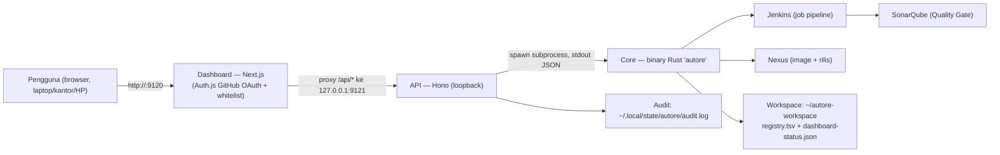

<p align="center">
  
</p>

<h1 align="center">Autore - Automation Tugure</h1>

<h3 align="center">CLI as the Brain, Web as the Interface</h3>

<p align="center">
  
  
  
  
  
  
</p>

<p align="center">
  <b>Platform CI/CD terstandarisasi untuk PT Tugu Reasuransi Indonesia</b><br/>
  Seluruh logika hidup di satu binary Rust <code>autore</code>; dashboard web hanya lapisan tampilan
  yang memanggilnya dan tidak pernah menduplikasi logikanya.
</p>

---

## Arsitektur



| Lapisan | Teknologi | Peran |
|---|---|---|
| Frontend | Next.js (App Router), React, Tailwind, lucide-react | Tampilan operasional: status pipeline, aplikasi, SBOM, skor, aksi. Terang saja (light-only) dan responsif sampai lebar ponsel. |
| API | Hono (Node.js), Auth.js v5 (JWT) | Sesi GitHub, whitelist, validasi body, pemetaan aksi ke argv CLI, jejak audit. Bind ke `127.0.0.1:9121` — tidak pernah terekspos ke LAN. |
| Core | Rust (`cli/`), tanpa dependensi runtime | Satu-satunya pemilik logika: `init`, `deploy`, `quick-start`, `scan`, `scan-image`, `sbom`, `status`, admin layanan. Semua perintah web dijalankan sebagai subprocess binary ini. |
| Integrasi | Jenkins Trusted Shared Library, Nexus OSS, SonarQube, Trivy, Gitleaks | Gerbang keamanan, registry immutable, kualitas kode, penyimpanan artefak. |
| State | `~/.config/autore/` (kredensial), `~/.local/state/autore/` (audit + PID), `~/autore-workspace/` (`registry.tsv`, `dashboard-status.json`) | Semua keadaan operasional ada di berkas, bukan di memori proses — dashboard bisa direstart tanpa kehilangan data. |

Prinsip yang tidak dilanggar:

- **Dashboard tidak punya logika bisnis.** Setiap aksi tombol menjadi pemanggilan subcommand `autore`.
- **API hanya di loopback.** Satu-satunya pintu dari jaringan adalah dashboard (`0.0.0.0:9120`), yang memverifikasi sesi GitHub lebih dulu.
- **Fail-closed.** Kalau sebuah scanner tidak benar-benar berjalan, pipeline gagal — bukan dilewati diam-diam.

---

## Fitur Utama

### Web Dashboard
Halaman: `/` (ringkasan pipeline terakhir, progres tahap, aksi), `/pipeline` (riwayat build 7 hari + filter), `/applications` (daftar aplikasi dari workspace), `/applications/sbom` (komponen SBOM CycloneDX per aplikasi + filter), `/security` (Security Score), `/login`, `/403`.

- **Light mode saja** — token warna operasional, tanpa alternatif gelap (`globals.css`: *light-only operational tokens, no dark alternatives exist by design*).
- **Responsif/mobile** — grid turun ke satu kolom (`grid-cols-1`) dan tabel lebar bisa digeser mendatar (`overflow-x-auto`) alih-alih memotong isi; navigasi utama tetap utuh di lebar ponsel.
- **Keadaan jujur** — data basi ditandai (`Gagal terhubung ke Jenkins. Menampilkan data terakhir.`), skeleton saat memuat, status `unknown` kalau data tidak ada.

### GitHub OAuth + Whitelist
Login GitHub via Auth.js (`GITHUB_ID`/`GITHUB_SECRET`/`NEXTAUTH_SECRET` di `web/.env`), lalu login diperiksa terhadap whitelist:

- Sumber kebenaran: `web/allowed-users.json`.
- Penimpa oleh operator: `AUTORE_ALLOWED_USERS` (dipisah koma, env tidak kosong menang).
- Perbandingan case-insensitive (`Alif` = `alif`); login kosong selalu ditolak.
- Login sah tapi tidak terdaftar diarahkan ke `/403` (halaman tolak dengan tombol keluar), bukan pesan error mentah.
- Halaman baca (`/api/status`, `/api/runs`, `/api/sbom/*`, `/api/active`) terbuka untuk sesi sah; aksi tulis (`/api/actions/*`) wajib sesi beridentitas.

### SBOM Viewer & Security Score
- **SBOM Viewer** — `/applications/sbom` menampilkan daftar komponen (nama, versi, tipe, lisensi) hasil `sbom.cdx.json` dari build, dengan filter pencarian; malformed SBOM tampil sebagai keadaan kosong yang jelas, bukan crash.
- **Security Score** — radar 5 sumbu di `/security`, semuanya dihitung dari data yang benar-benar ada (`lib/score.ts`): `security` (gerbang lolos dari total), `reliability` (build sukses dari total build), `speed` (median durasi build sukses terhadap target 2 menit), `freshness` (umur build terakhir, ≤24 jam), `coverage` (aplikasi yang pernah dibangun dari seluruh aplikasi). Sumbu tanpa data bernilai **null** dan tidak digambar — radar yang lebih kecil lebih jujur daripada sumbu bernilai nol karangan.

### Audit Trail & Identity Propagation
- Setiap aksi tulis dari dashboard dicatat satu baris JSONL ke `~/.local/state/autore/audit.log` (`AUTORE_AUDIT_LOG` bisa menimpanya): `ts`, `login`, `email`, `action`, `target`, `exit`. Baris ringkas juga masuk stdout sehingga ikut terbaca `autore logs`.
- **Identitas menempel ke Git**: nama dan email dari sesi GitHub diteruskan ke CLI sebagai author commit di repo aplikasi (`user.name`/`user.email`), jadi `git log` menceritakan siapa menekan tombol — bukan akun bot. Tanpa sesi, CLI memakai identitas bawaan `Autore CLI <autore@tugu-re.com>`.
- Audit adalah efek samping, bukan prasyarat: kegagalan menulis log tidak menggagalkan deploy, hanya muncul di journal.

### Multi-Language Support
`autore init` / `quick-start` menghasilkan `Dockerfile` + `Jenkinsfile` + `.dockerignore` untuk empat stack: **Python** (`python:3.12-slim`, non-root), **Node.js** (`node:20-alpine`, `USER node`), **Java** (`maven:3.9-eclipse-temurin-21` build → `eclipse-temurin:21-jre-jammy` runtime), **Go** (build statis). Setiap template punya tahap test di dalam image build dan entrypoint yang jelas gagalnya kalau artefak tidak ditemukan. `--deploy-port` memisahkan port host antar-project supaya tidak bentrok.

### Friendly Launcher
`autore` tanpa argumen tidak lagi langsung masuk TUI. Muncul menu tugas:

```text
Pilih tugas:
  [1] Web Dashboard   - nyalakan layanan, cek kesehatan, cetak URL
  [2] TUI Legacy      - antarmuka layar penuh lama (panel menu + command palette)
  [3] Keluar
  [4] Admin           - Start / Stop / Restart / Logs
```

- Bukan TTY (output dipipe) → mencetak panduan singkat lalu keluar, tidak menggantung.
- Penjaga user: perintah layanan hanya jalan untuk user pemilik sesi systemd; user lain ditolak dengan pesan jelas sebelum `systemctl` dipanggil.

### Admin Commands
Wrapper systemd supaya tim IT tidak mengetik perintah panjang:

| Perintah | Efek |
|---|---|
| `autore start` \| `stop` \| `restart` | Satu panggilan `systemctl --user start/stop/restart autore-web-api autore-web-dashboard`, lalu mencetak status kedua unit. |
| `autore logs` | `journalctl --user -u autore-web-api -u autore-web-dashboard -f`. `--no-follow` mencetak 50 baris terakhir; `--lines N` mengubah jumlahnya. |
| `autore` → `[4]` | Sub-menu Admin berputar sampai `[5] Kembali` — start, cek log, restart tanpa keluar-masuk menu. |

Kalau `systemctl` tidak ada (macOS/container), Autore otomatis memakai jalur cadangan berbasis berkas PID (`~/.local/state/autore/api.pid`, `dashboard.pid`) dan tetap bisa `start`/`stop`.

---

## Quick Start

### 1. Pasang CLI

```bash
curl -fsSL https://raw.githubusercontent.com/tugure-git-intern/Autore/main/install.sh | bash
# Windows PowerShell:
# irm https://raw.githubusercontent.com/tugure-git-intern/Autore/main/install.ps1 | iex
```

Kompilasi manual:

```bash
cargo build --release --manifest-path cli/Cargo.toml
install -m755 cli/target/release/autore ~/.local/bin/autore
```

### 2. Jalankan dashboard

```bash
autore          # pilih [1] Web Dashboard
```

Pilihan `[1]` menyalakan/memeriksa layanan, menunggu sampai sehat, lalu mencetak URL. Ekuivalen CLI:

```bash
autore start    # systemctl --user start kedua unit
autore status   # ringkasan cepat
autore logs     # ikuti log (Ctrl-C untuk berhenti)
```

### 3. Buka dari browser

```
http://100.80.3.14:9120        # lewat Tailscale (laptop kantor/rumah, HP)
```

Dashboard bind `0.0.0.0:9120`; API tetap `127.0.0.1:9121`. Port lain di sandbox: Jenkins `:8080`, Nexus `:8082`, SonarQube `:9000`, registry Docker `:5000`.

Layanan berjalan sebagai unit **systemd user** (`deploy/autore-web-api.service`, `deploy/autore-web-dashboard.service`) dengan `linger` aktif, jadi tetap hidup setelah terminal ditutup.

---

## CLI Reference

| Perintah | Alias | Deskripsi |
|---|---|---|
| `autore` | — | Menu interaktif (Web Dashboard / TUI Legacy / Keluar / Admin). Non-TTY: panduan singkat. |
| `autore status` | `st` | Status sistem & pipeline terakhir dari `dashboard-status.json`. |
| `autore runs` | — | Riwayat build Jenkins 7 hari terakhir (sumber grafik dashboard). |
| `autore active` | — | Pipeline yang sedang berjalan atau menunggu di Jenkins. |
| `autore deploy` | `dep` | Daftarkan project ke Jenkins CI/CD dan langsung trigger build. |
| `autore quick-start` | `qs` | Alur 1-klik: file pipeline → repo GitHub → push → daftar Jenkins → trigger build. |
| `autore init` | `in` | Generate `Dockerfile`, `Jenkinsfile`, `.dockerignore` untuk python/nodejs/java/go. |
| `autore doctor` | `doc` | Kesehatan Runner, Docker, Java, Jenkins. |
| `autore scan` | — | Gerbang keamanan pra-build: Static Guard + Gitleaks + Trivy (Docker). `--no-docker` untuk mode cepat tanpa kontainer. |
| `autore scan-image` | — | Gerbang pasca-build pada image: UID non-root + Trivy image + SBOM CycloneDX. |
| `autore hook install \| status \| uninstall` | — | Kelola Git pre-commit hook ("Satpam Pintu 1"). |
| `autore sbom` | — | Daftar dependensi dari SBOM CycloneDX hasil build (dipakai dashboard). |
| `autore pipeline record` | — | Catat satu peristiwa pipeline (tahap/status/log) ke `dashboard-status.json`; dipakai pipeline Jenkins. |
| `autore serve` | — | Jalankan dashboard web (satu kotak "Buat" yang menjalankan alur 1-klik). |
| `autore kemampuan` | — | Kemampuan mesin ini sebagai data (dipakai dashboard). |
| `autore update` | — | Unduh rilis stabil terbaru dari GitHub Releases, verifikasi `SHA256SUMS`, ganti binary atomik. |
| `autore start \| stop \| restart` | — | Kelola layanan dashboard via `systemctl --user`. |
| `autore logs` | — | Ikuti log kedua layanan (`--no-follow`, `--lines N`). |

Alias lengkap: **`st`, `dep`, `qs`, `doc`, `in`** — semuanya tampil di `autore --help`.

```bash
autore st                          # alias status
autore init --app-name klaim-api --stack python --app-port 8000 --deploy-port 8083
autore scan --no-docker --path .   # gerbang cepat pra-commit (<1 detik)
autore scan-image --image 127.0.0.1:5000/klaim-api:build-42 --severity HIGH,CRITICAL \
  --sbom-output dist/sbom.cdx.json
autore logs --no-follow            # 50 baris terakhir lalu keluar
```

**Catatan:** autentikasi CLI (`autore deploy`/`quick-start`) menanyakan kredensial sekali lalu menyimpannya di `~/.config/autore/` (`github_token`, `jenkins.conf`). Kredensial Jenkins/Nexus tidak pernah dicetak ke terminal atau log.

---

## Security Gates (9 Tahap Fail-Closed)

Pipeline otoritatif ada di repositori admin (`vars/autorePipeline.groovy`), bukan di repo aplikasi — pembuat PR tidak bisa melemahkan gerbangnya. Setiap tahap gagal = pipeline berhenti, tidak ada tahap yang dilewati diam-diam.

| # | Tahap | Yang diperiksa |
|---|---|---|
| 1 | **Checkout & Audit Metadata** | Commit SHA 40-hex penuh (menolak `SHORT_SHA`/`latest`), menyiapkan metadata audit. |
| 2 | **Autore Static Guard & Gitleaks** | Static Byte Guard native + deteksi kebocoran kredensial dengan Gitleaks. |
| 3 | **Trivy Source & Config Scan** | Kerentanan dependensi (SCA) + salah konfigurasi Dockerfile, level HIGH/CRITICAL. |
| 4 | **Clippy & SonarQube SAST Gate** | Ekspor Clippy + `sonar-scanner`; dilewati hanya kalau proyek memang bukan Rust (`cli/Cargo.toml` tidak ada). |
| 5 | **Build Image & Static musl Binary** | `docker build` dengan tag immutable + binary Rust musl statis. |
| 6 | **Trivy Final Image Scan & SBOM** | UID non-root + CVE image HIGH/CRITICAL + ekspor SBOM CycloneDX. |
| 7 | **Verify Checksums** | `SHA256SUMS` untuk artefak rilis. |
| 8 | **Push to Nexus & Verify Remote Digest** | Repositori `ALLOW_ONCE` (tanpa redeploy) + verifikasi digest lewat `HEAD` terotentikasi. |
| 9 | **Deploy by Verified Digest** | Deploy memakai `@sha256:<digest>` yang sudah diverifikasi — bukan tag yang bisa bergeser. |

Notifikasi hasil (lolos `9/9` atau gagal berikut nama tahapnya) dikirim ke Telegram oleh `scripts/notify-telegram.sh`. Di sisi developer, pintu pertama tetap lokal: `autore hook install` memasang pre-commit hook yang memanggil `autore scan`.

---

## Troubleshooting

**Port bentrok (`EADDRINUSE`) saat pilih `[1]` atau `autore start`**
Dashboard memakai `9120` dan API `9121`. Cek pemakai port: `ss -ltnp | grep -E '9120|9121'`. Kalau yang menahan adalah layanan Autore yang basi: `autore restart`. Untuk aplikasi yang akan di-deploy, beri port host berbeda sejak awal: `autore init --deploy-port 8083`.

**Gagal login / diarahkan ke `/403`**
Anda lolos GitHub tetapi tidak ada di whitelist. Tambahkan username (case-insensitive) ke `web/allowed-users.json`, atau set `AUTORE_ALLOWED_USERS="user1,user2"` di `web/.env` (env tidak kosong menimpa berkas). Setelah mengubah `.env`: `autore restart`. Kalau halaman login malah error, biasanya `GITHUB_ID`/`GITHUB_SECRET`/`NEXTAUTH_SECRET` belum terisi di `web/.env`.

**Audit log kosong**
`~/.local/state/autore/audit.log` hanya ditulis oleh **aksi tulis** dari dashboard (`deploy`, `quick-start`, `scan`) — membuka halaman tidak menulis apa pun. Cek juga `AUTORE_AUDIT_LOG`/`XDG_STATE_HOME`: kalau salah satu diset di unit layanan, berkasnya berpindah ke sana. Baris ringkas juga bisa dibaca langsung: `autore logs`.

**Dashboard menampilkan data lama**
Artinya API atau Jenkins tidak terjangkau; kartu akan menandainya (`Gagal terhubung ke Jenkins. Menampilkan data terakhir.`). Cek `autore logs`, lalu `autore status`. Data yang tidak ada ditampilkan sebagai `unknown`/kosong, bukan angka karangan.

**Layanan mati setelah terminal ditutup**
Cek `loginctl show-user $USER -p Linger` harus `Linger=yes`; kalau tidak: `loginctl enable-linger $USER`. Sesudah itu `autore start`.

**`autore` tidak bereaksi di skrip/CI**
Output bukan TTY, jadi menu sengaja diganti panduan singkat. Pakai subcommand eksplisit (`autore status`, `autore runs`).

**Ada tes CLI yang merah**
`cli/tests/sbom_cli.rs` punya satu tes lama yang merah (perbedaan nama direktori workspace `autore-workspace` vs `.autore-workspace`), tidak berkaitan dengan fitur aplikasi. Sisanya hijau.

---

## Testing

```bash
# CLI Rust (dari cli/, butuh export PATH=$HOME/.cargo/bin:$PATH)
cargo test --bin autore          # 284 lolos
cargo test --test admin_cli      # 7 lolos
cargo test --test launcher_cli   # 5 lolos

# Dashboard & API (dari web/)
npm test                         # 506 tes / 57 berkas, semua lolos
```

---

## Struktur Repositori

```text
Autore/
├── install.sh / install.ps1      # Installer 1-baris (Linux musl / Windows), verifikasi SHA-256
├── cli/                          # Core: binary Rust `autore` (semua logika)
│   ├── src/                      # main.rs + admin.rs, launcher.rs, tui.rs, templates.rs, scanner.rs,
│   │                             # sbom.rs, status.rs, runs.rs, jenkins.rs, github.rs, doctor.rs, ...
│   ├── tests/                    # Tes integrasi biner: admin_cli, launcher_cli, scan_cli, sbom_cli
│   └── Cargo.toml
├── web/                          # Interface: monorepo npm (workspaces)
│   ├── apps/dashboard/           # Next.js — halaman /, /pipeline, /applications(+sbom), /security, /login, /403
│   ├── apps/api/                 # Hono — sesi GitHub, whitelist, aksi, audit, status/runs/sbom/active
│   ├── allowed-users.json        # Whitelist GitHub (sumber kebenaran)
│   └── .env                      # Rahasia saja: GITHUB_ID, GITHUB_SECRET, NEXTAUTH_SECRET, AUTORE_ALLOWED_USERS
├── deploy/                       # Unit systemd user: autore-web-api, autore-web-dashboard
├── vars/autorePipeline.groovy    # Jenkins Trusted Shared Library — 9 gerbang fail-closed
├── scripts/                      # ci-sonarqube-gate.sh, ci-nexus-publish.sh, ci-deploy-by-digest.sh,
│                                 # build-musl-release.sh, publish-release.sh, notify-telegram.sh
├── runner/                       # Provisioning + service Jenkins Agent (setup-agent.sh, jenkins-agent.service)
├── sandbox/                      # Lingkungan uji: services/ (SonarQube, Nexus), jenkins/, dummy-app/
├── docs/                         # PRODUCTION-ISOLATION-DESIGN.md + plans/ (riwayat rencana fitur)
├── assets/banner.png
└── Jenkinsfile                   # Pipeline CI/CD repo Autore sendiri
```

---

## Peringatan Keamanan Sandbox (C-1, C-2, H-6)

> [!WARNING]
> Konfigurasi di repositori ini adalah **lingkungan uji coba (sandbox)**, belum production-ready:
> 1. **C-1 — Keanggotaan grup `docker` di host.** User runner berada di grup `docker` (setara akses root). Jangan menaruh kredensial produksi dan jangan menjalankan PR dari sumber tidak tepercaya. Untuk produksi, runner wajib memakai container ephemeral + rootless builder sesuai [`docs/PRODUCTION-ISOLATION-DESIGN.md`](docs/PRODUCTION-ISOLATION-DESIGN.md).
> 2. **C-2 — Pipeline otoritatif.** Build wajib lewat Jenkins Trusted Shared Library milik admin (`vars/autorePipeline.groovy`), bukan skrip yang bisa dimodifikasi pembuat PR. Repo aplikasi diperlakukan sebagai *untrusted input*.
> 3. **H-6 — Akses jaringan.** Tidak ada layanan yang bind ke `0.0.0.0` kecuali dashboard (`9120`). API `127.0.0.1:9121`; Jenkins `127.0.0.1:8080` + tailnet `:8080`; Nexus loopback + tailnet `:8082`; SonarQube loopback + tailnet `:9000`; registry Docker `127.0.0.1:5000`. Akses dari luar hanya lewat Tailscale.
