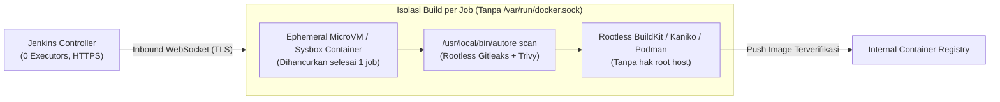
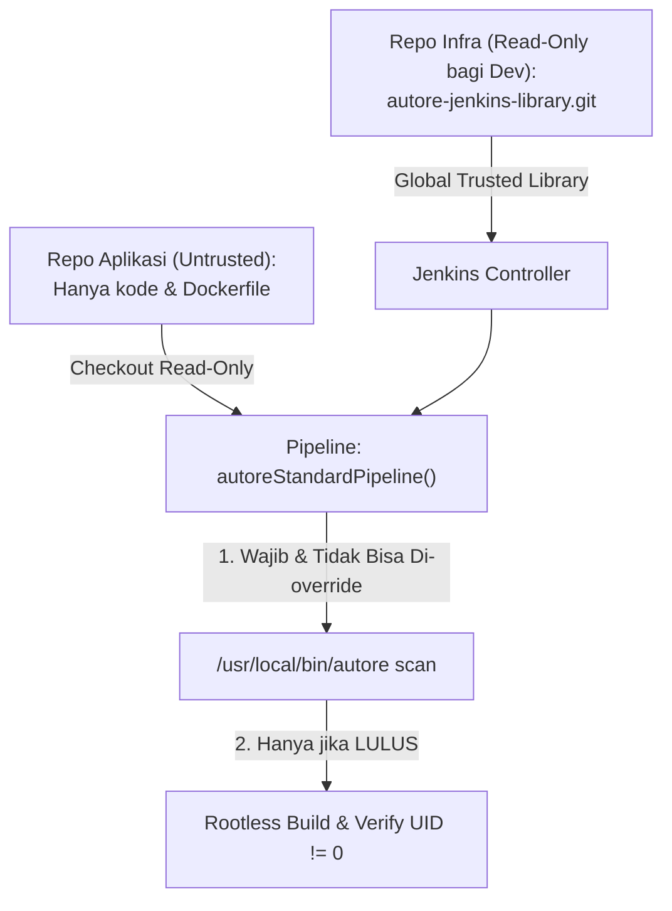

# Desain Isolasi Produksi & Dokumentasi Risiko Sandbox (C-1, C-2, H-6)

Dokumen ini mendefinisikan batas risiko sementara untuk lingkungan **Sandbox VPS** serta arsitektur target sebelum platform **Autore** dipasang pada lingkungan produksi kantor.

---

## 1. Status Risiko Sementara Khusus Sandbox (Wajib Dipatuhi)

Konfigurasi di direktori `runner/` dan `sandbox/` saat ini dirancang **khusus untuk pembuktian konsep (PoC) di VM Sandbox terisolasi** dan memiliki dua risiko arsitektural yang diterima sementara dengan batasan ketat:

### C-1: User `jenkins` di Grup `docker` Host (= Akses Setara Root di Host Sandbox)
- **Mekanisme:** `runner/setup-agent.sh` menambahkan user `jenkins` ke grup `docker` agar pipeline dapat menjalankan `docker build` dan `docker run` secara langsung di atas daemon Docker host.
- **Dampak:** Setiap job yang berjalan di `vps-runner-1` dapat me-mount filesystem host (`docker run -v /:/host`) atau membaca container lain di mesin yang sama.

### C-2: Definisi `Jenkinsfile` Berada di Repositori yang Sedang Di-build
- **Mekanisme:** Meskipun `autore scan` kini dijalankan dari binary terpercaya milik root (`/usr/local/bin/autore`) dan tidak lagi mengeksekusi script dari repositori yang di-scan, file `Jenkinsfile` itu sendiri masih dibaca dari repositori target.
- **Dampak:** Siapa pun yang memiliki hak push ke branch yang di-poll oleh Jenkins dapat memodifikasi `Jenkinsfile` untuk melewati stage `Security Gate` atau mengeksekusi perintah di runner.

### Aturan Operasional Wajib Selama Fase Sandbox
1. **DILARANG menaruh kredensial produksi** (database produksi, private key server kantor, token cloud produksi) di Jenkins Sandbox atau di host `vps-runner-1`.
2. **DILARANG menjalankan build otomatis pada Pull Request (PR) dari pihak/fork yang tidak dipercaya.** Polling SCM hanya boleh mengarah ke branch internal yang dilindungi (*protected branch*).
3. **DILARANG memasang `runner/setup-agent.sh` mode grup `docker` host ini sebagai production runner kantor** tanpa menerapkan desain isolasi pada Bagian 2 dan Bagian 3 di bawah.

---

## 2. Desain Remediasi C-1: Runner Ephemeral & Rootless Image Builder

Untuk menghilangkan akses setara `root` pada host runner produksi, eksekusi build dan pembuatan image container dipisahkan dari daemon Docker host utama:



### Komponen Implementasi Produksi (C-1)
1. **Builder Tanpa Grup `docker` Host (Pilih salah satu):**
   - **Rootless Podman / Buildah:** User `jenkins` menjalankan container dan membangun image menggunakan *user namespaces* (`subuid`/`subgid`) tanpa akses ke socket root.
   - **Kaniko / Rootless BuildKit:** Stage `Build & Test` membangun image di dalam ruang pengguna dan mendorong hasilnya ke registry internal tanpa memerlukan daemon Docker berhak `root`.
2. **Ephemeral Runner (Sekali Pakai):**
   - Setiap build dijalankan di dalam lingkungan sekali pakai (Cloud/KVM ephemeral VM atau container terisolasi penuh dengan Sysbox/Kata Containers) yang langsung dihapus setelah build selesai.
   - Tidak ada state, cache rahasia, atau container aplikasi yang bertahan di node builder.
3. **Pemisahan Host Builder vs Host Target Deploy:**
   - Node runner **hanya** melakukan pemindaian keamanan (`autore scan`), unit test, dan pembuatan image.
   - Deployment container aplikasi dilakukan pada host staging/produksi terpisah melalui mekanisme pull dari registry internal, bukan `docker run` langsung di mesin builder.

---

## 3. Desain Remediasi C-2: Admin-Controlled Jenkins Shared Library

Agar repositori aplikasi tidak dapat memodifikasi atau melewati `Security Gate`, definisi pipeline dipindahkan dari repositori aplikasi ke **Jenkins Global Trusted Shared Library** yang dikelola khusus oleh tim Infrastruktur/SecOps.



### Struktur Shared Library (`autore-jenkins-library`)
1. **Repositori Terpisah & Terkunci:**
   - Disimpan di repositori khusus admin (mis. `tugure-infra/autore-jenkins-library`), di mana developer aplikasi tidak memiliki akses tulis.
   - Didaftarkan di Jenkins pada `Manage Jenkins -> System -> Global Trusted Pipeline Libraries`.
2. **Entry Point Tunggal (`vars/autorePipeline.groovy`):**
   - Seluruh tahapan (`Audit Info`, `Security Gate` via `/usr/local/bin/autore scan`, `Build & Test` + verifikasi UID `!= 0`, `Deploy`, `Smoke Test`, dan `Telegram Audit`) dikodekan secara terpusat di dalam `vars/autorePipeline.groovy`.
   - Repositori aplikasi hanya boleh memiliki file deklaratif minimal 1 baris:
     ```groovy
     @Library('autore-trusted-lib') _
     autorePipeline(appName: 'my-service', appPort: 8000, deployPort: 8081)
     ```
   - Atau menggunakan plugin **Pipeline from SCM with Marker File / Job DSL** yang sepenuhnya mengabaikan perubahan logika pipeline dari repositori aplikasi.
3. **Kebijakan Branch & PR:**
   - Branch `main` wajib mengaktifkan *Branch Protection* (wajib code review minimal 1 engineer senior/SecOps, larang force-push).
   - PR dari luar/untrusted branch hanya menjalankan tahap verifikasi statis di lingkungan terisolasi tanpa akses ke kredensial apa pun (termasuk token notifikasi).

---

## 4. Desain Konektivitas Controller & Agent (H-6)

Pada [`sandbox/jenkins/docker-compose.yml`](../sandbox/jenkins/docker-compose.yml), port Jenkins Controller kini diikat secara ketat ke loopback host:
```yaml
ports:
  - "127.0.0.1:8080:8080"
```

### Bagaimana Koneksi Bekerja Tanpa Memutus Agent?
1. **Agent Lokal di Host yang Sama (`vps-runner-1`):**
   - Service `jenkins-agent.service` berjalan di host yang sama dan menghubungi `JENKINS_URL=http://localhost:8080/` (`127.0.0.1:8080`) melalui WebSocket (`-webSocket`).
   - Karena menggunakan antarmuka loopback (`lo`), pengikatan `127.0.0.1:8080:8080` **tidak memutus koneksi agent lokal** sekaligus menutup akses langsung dari jaringan LAN/publik.
2. **Akses Browser Operator (Laptop ke Sandbox VPS):**
   - Operator membuka SSH local port-forwarding dari laptop:
     ```bash
     ssh -L 8080:127.0.0.1:8080 <user>@<ip-vps>
     ```
   - Lalu mengakses `http://localhost:8080` secara aman melalui terowongan SSH terenkripsi.
3. **Agent di Mesin Berbeda / Lingkungan Produksi:**
   - **Opsi A (Produksi — Direkomendasikan):** Pasang reverse proxy HTTPS (Nginx/Caddy) di depan `127.0.0.1:8080` dengan sertifikat TLS valid, sehingga agent eksternal terhubung ke `https://jenkins.internal.tugu-re.com/` via WebSocket terenkripsi (`wss://`) dan memverifikasi SHA-256 checksum `agent.jar`.
   - **Opsi B (Sandbox Multi-Host):** Gunakan systemd tunnel `ssh -N -L 127.0.0.1:8080:127.0.0.1:8080` dari mesin runner ke mesin controller.
