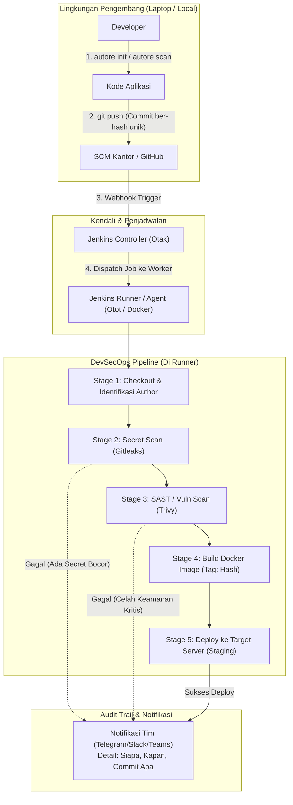
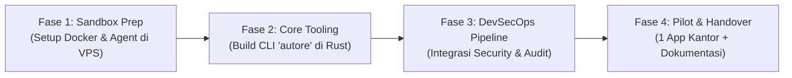

# Blueprint & Roadmap Platform CI/CD: "Autore"
**Unit IT Infrastructure — PT Tugu Reasuransi Indonesia**  
*Dokumen Rencana Arsitektur, DevSecOps, Tooling Rust, dan Serah Terima Sistem*

---

## 1. Ringkasan Eksekutif

Proyek ini bertujuan memodernisasi dan membangun **Platform CI/CD Tim** yang terstandarisasi, aman, dan berkelanjutan. Saat ini, sistem Jenkins kantor masih menjalankan semua proses build di mesin *Controller*, yang membahayakan stabilitas dan keamanan.

Melalui proyek ini, tim magang tidak hanya membangun pipeline sekali pakai, melainkan menghadirkan **ekosistem tooling lengkap** bernama **`Autore`**:
1. **Dedicated Jenkins Runner**: Memindahkan beban komputasi dari Controller ke worker node khusus.
2. **CLI Developer Tool (`autore`) berbasis Rust**: Tool berkinerja tinggi, berukuran kecil, tanpa dependensi (*single binary*) untuk scaffolding pipeline dan audit lokal.
3. **DevSecOps Security Gate**: Menyaring kode berbahaya, password/secret bocor, dan celah dependensi sebelum menyentuh server staging/production.
4. **Audit Trail & Traceability**: Pelacakan identitas pelaku perubahan (*author*, *commit hash*, *build user*) secara transparan guna mencegah saling tuduh.
5. **Dokumentasi & Handover**: Prosedur standar operasional (SOP) agar platform tetap dirawat dan digunakan setelah masa magang berakhir.

---

## 2. Arsitektur Sistem



---

## 3. Komponen Utama Platform

### A. Tool CLI `autore` (Ditulis dengan Rust)
Didesain sebagai *single static executable* tanpa memerlukan runtime Python/Node.js di komputer developer maupun server.

* **Fitur Utama:**
  * `autore init`: Wizard interaktif untuk menghasilkan konfigurasi `Jenkinsfile`, `Dockerfile`, dan `docker-compose.yml` standar kantor sesuai bahasa pemrograman (Node.js, Java, Python, Go, PHP).
  * `autore scan`: Menjalankan security audit lokal (secret scanner & linting) sebelum developer melakukan `git push`.
  * `autore agent setup`: Script otomatisasi untuk setup VM baru menjadi Jenkins Runner (install Java, Docker, user permissions, dan systemd service).
  * `autore doctor`: Diagnostik kesehatan lingkungan (cek koneksi controller, status docker socket, sisa kapasitas storage runner).

### B. DevSecOps & Penangkis Kode Berbahaya (Permintaan Leader)
Mencegah potensi kerentanan masuk ke lingkungan kantor:
1. **Secret Scanning (Gitleaks)**: Menghentikan proses build seketika bila mendeteksi string menyerupai kata sandi database, API key, atau private certificate.
2. **Vulnerability & Container Scanning (Trivy)**: Memindai base image Docker dan dependensi paket pihak ketiga. Build dibatalkan otomatis jika ada celah berstatus `CRITICAL`.
3. **Static Application Security (Semgrep / Linter)**: Memeriksa kode berbahaya atau pola coding yang berpotensi injeksi sebelum kompilasi.

### C. Akuntabilitas & Anti Saling Tuduh (*Audit Trail*)
Setiap aksi deployment memiliki identitas mutlak:
* **Tag Docker Non-Latest**: Seluruh image yang dihasilkan dilabeli secara unik, contoh: `repo/aplikasi:build-42-commit-a3f12c9`.
* **Metadata Stamp**: Jenkins mencatat variabel sistem:
  * `GIT_AUTHOR_NAME` & `GIT_AUTHOR_EMAIL` (pembuat kode).
  * `BUILD_USER` (orang yang menjalankan build/approval).
  * `GIT_COMMIT` & `GIT_BRANCH`.
* **Notifikasi Transparan**: Hasil build dikirim ke kanal komunikasi tim lengkap dengan nama pelaku perubahan dan pesan commit.

---

## 4. Struktur Repositori `Autore`

Struktur repositori [https://github.com/tugure-git-intern/Autore](https://github.com/tugure-git-intern/Autore):

```text
Autore/
├── cli/                         # Source code CLI Rust (`autore`)
│   ├── Cargo.toml
│   └── src/
│       ├── main.rs              # Entry point CLI (Clap)
│       ├── commands/            # Subcommand: init, scan, agent, doctor
│       └── templates/           # Embedded templates (Jenkinsfile, Dockerfile)
│
├── runner/                      # Konfigurasi & Service Runner
│   ├── setup-agent.sh           # Bash provisioner untuk Ubuntu Server
│   └── jenkins-agent.service    # Systemd daemon config
│
├── pipelines/                   # Referensi Pipeline Standard
│   ├── Jenkinsfile.node         # Template standar NodeJS
│   ├── Jenkinsfile.java         # Template standar Java/Spring
│   └── Jenkinsfile.python       # Template standar Python
│
├── docs/                        # Dokumentasi & SOP Handover
│   ├── 01-arsitektur-cicd.md
│   ├── 02-setup-runner-guide.md
│   ├── 03-developer-guide.md    # Panduan developer memakai template
│   ├── 04-troubleshooting.md    # Penanganan runner putus / disk penuh
│   └── 05-handover-checklist.md # Berita acara serah terima
│
└── README.md                    # Panduan ringkas repositori
```

---

## 5. Rencana Eksekusi Bertahap (Roadmap)



### **Fase 1: Persiapan Playground VPS (Minggu 1)**
* Menyiapkan dependensi di VPS: Docker Engine, OpenJDK, Git.
* Konfigurasi koneksi Jenkins Controller ↔ Agent via Inbound Agent / WebSocket.
* Validasi build sederhana berjalan lancar di worker node terisolasi.

### **Fase 2: Pengembangan Tool Rust `autore` (Minggu 2)**
* Inisialisasi project Cargo di repo `Autore`.
* Implementasi sub-perintah `autore init` (templating interaktif).
* Implementasi sub-perintah `autore agent setup` dan `autore doctor`.

### **Fase 3: Penguatan DevSecOps & Audit Trail (Minggu 3)**
* Integrasi Gitleaks dan Trivy ke dalam template `Jenkinsfile`.
* Pengujian penghentian otomatis build saat kode dummy sengaja disisipi kata sandi bocor.
* Konfigurasi webhook notifikasi tim untuk pelaporan identitas commit.

### **Fase 4: Uji Coba Pilot Aplikasi & Serah Terima (Minggu 4)**
* Minta persetujuan leader untuk memilih 1 aplikasi tim (lingkungan non-production/staging).
* Menerapkan pipeline pada aplikasi pilot.
* Melakukan transfer pengetahuan ke 1 rekan tim yang ditunjuk sebagai penanggung jawab lanjutan.
* Finalisasi dokumen SOP di folder `docs/`.

---

## 6. Kriteria Keberhasilan (*Legacy Metric*)

| Aspek | Kondisi Awal | Target Keberhasilan |
| :--- | :--- | :--- |
| **Beban Controller** | Semua job berjalan di controller | Beban controller 0%, 100% build diproses di Runner terpisah |
| **Keamanan Kode** | Belum ada filter otomatis | Secret dan celah kritis terblokir otomatis sebelum tahap deploy |
| **Akuntabilitas** | Deployment manual / minim jejak | Setiap container terlacak hingga ke level commit hash dan author |
| **Kemudahan Developer** | Merakit pipeline manual | 1 perintah `autore init` langsung menghasilkan pipeline siap pakai |
| **Keberlanjutan** | Proyek magang selesai hilang | Dokumentasi lengkap & ada anggota tim yang mampu mengoperasikan |
