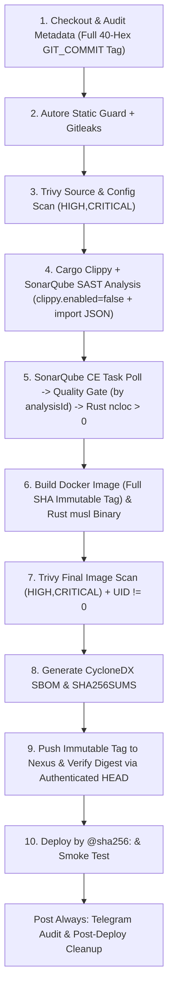

# Spesifikasi Arsitektur (Revisi v2): Integrasi Trivy (Source + Image), SonarQube (SAST + Quality Gate), & Nexus Repository

**Tanggal:** 29 Oktober 2026  
**Status:** Revisi v2 (Menunggu Persetujuan Diff sebelum Implementasi Kode)  
**Cakupan:** Platform CI/CD & DevSecOps `Autore`  

> **PERINGATAN STATUS ARSITEKTUR (C-1 & SONARQUBE ADVISORY — BELUM PRODUCTION-READY):**  
> 1. **Risiko C-1 (Grup `docker` Host):** Selama runner Jenkins (`vps-runner-1`) masih menggunakan keanggotaan grup `docker` pada host (`runner/setup-agent.sh`), lingkungan ini berstatus **Sandbox / PoC Validation** dan **BELUM production-ready**. Keanggotaan grup `docker` setara dengan akses `root` di host. Jangan menaruh kredensial produksi atau menjalankan PR dari sumber yang tidak dipercaya di mesin ini. Untuk produksi kantor, runner wajib dimigrasikan ke runner ephemeral + rootless builder sesuai [`docs/PRODUCTION-ISOLATION-DESIGN.md`](../../PRODUCTION-ISOLATION-DESIGN.md).  
> 2. **Advisory Keamanan SonarQube `26.10.0.133078-community` (eMudhra CA Trust):** Image `sonarqube:26.10.0.133078-community` terdampak advisory resmi SonarSource terkait sertifikat root CA **eMudhra (`emSign`)** di dalam JVM truststore (`cacerts`). Versi ini ditetapkan sebagai **pinned PoC version** dengan penerapan **mitigasi resmi penghapusan alias eMudhra dari `cacerts`**, dan **tidak boleh diklaim production-ready** sebelum rilis tetap (*fixed release*) tersedia dan dipasang.

---

## 1. Evaluasi & Keputusan Arsitektur

### 1.1 Pemisahan Tegas: Admin-Controlled Orchestrator vs Untrusted Application Repo
1. **Repositori Aplikasi Diperlakukan Sebagai Data Tidak Dipercaya (*Untrusted Input*):**
   - Pipeline CI **dilarang** mengeksekusi script keamanan atau script publish dari dalam workspace repositori yang sedang diperiksa (`$WORKSPACE/scripts/...`).
   - **Jenkins Shared Library (`vars/autorePipeline.groovy`)** dan seluruh skrip orchestrator authoritative (`ci-sonarqube-gate.sh`, `ci-nexus-publish.sh`, `ci-deploy-by-digest.sh`, `build-musl-release.sh`) wajib berada di **repositori yang dikontrol admin** (dan dipasang di direktori milik `root` seperti `/usr/local/lib/autore-ci/` dengan izin `0755`), terpisah dari repositori aplikasi.
2. **Mode CLI Rust (`autore`) — Deterministik & Bebas Ketergantungan Server Eksternal:**
   - `autore` tidak bergantung pada koneksi SonarQube atau Nexus agar tetap dapat digunakan secara mandiri tanpa kredensial server di workstation developer.
   - Tiga mode operasi eksplisit:
     - `autore scan --no-docker` (**Scan Ringan Lokal / Pre-Commit**): Menjalankan Static Byte Guard + pemeriksaan `USER` non-root pada `Dockerfile` secara lokal tanpa memanggil Docker container (berlabel `NON-AUTHORITATIVE`). Durasi eksekusi akan diukur secara aktual saat pengujian, bukan diasumsikan.
     - `autore scan` (**Full Scan CI — Pre-Build Source & Config**): Menjalankan Static Byte Guard + **Gitleaks** container (pinned digest, `--network none`) + **Trivy Filesystem/Config** container (`--scanners vuln,misconfig --severity HIGH,CRITICAL --exit-code 1`, memverifikasi laporan JSON terbentuk).
     - `autore scan-image --image <immutable-image-tag> [--severity HIGH,CRITICAL] [--sbom-output <path>]` (**Full Scan CI — Post-Build Image**): Memverifikasi UID efektif image `!= 0`, menjalankan **Trivy Image Scan** (`--scanners vuln --severity HIGH,CRITICAL --exit-code 1` + validasi laporan JSON), dan mengekspor **SBOM CycloneDX** (`sbom.cdx.json`).

### 1.2 Pinning Digest Image & Peran Saling Melengkapi (*Defense-in-Depth*)

Seluruh container scanner dan layanan di-pin menggunakan **SHA-256 manifest digest** (dilarang menggunakan tag mutable tanpa digest atau `:latest`):

| Komponen | Image & Digest Ter-pin (`@sha256:...`) | Fungsi Otoritatif & Aturan Integrasi |
| :--- | :--- | :--- |
| **`cargo clippy`** | Toolchain Rust host/builder | Menjalankan `cargo clippy --all-targets -- -D warnings` (fail-closed pada warning) dan mengekspor `clippy-report.json` (`--message-format=json`). |
| **SonarQube Community Build (Pinned PoC Version)** | `sonarqube:26.10.0.133078-community@sha256:aa0d41212704d1ed35f7ae3b49886b39f639590baf8020cdb191c2a2eb8f9eae` | **Melengkapi `cargo clippy`**, **bukan** pengganti `Autore`, `Gitleaks`, atau `Trivy`. Wajib menerapkan mitigasi resmi penghapusan CA eMudhra (`emsign*`) dari JVM `cacerts`. |
| **SonarScanner CLI** | `sonarsource/sonar-scanner-cli:12.3.0.4285_8.1.0@sha256:47956b669bf486bdad919e1cbd0533223515aa0b6d1d31763e5a3754942df6d7` | Karena analyzer Rust SonarQube menjalankan Clippy secara default, scanner dijalankan dengan **`-Dsonar.rust.clippy.enabled=false`** dan mengimpor laporan eksternal **`-Dsonar.rust.clippyReport.reportPaths=clippy-report.json`** agar tidak terjadi duplikasi eksekusi atau kegagalan mencari `cargo` di dalam container scanner. |
| **Autore Static Byte Guard** | `/usr/local/bin/autore` (root-owned `0755`) | Penegakan aturan kebijakan keamanan internal (fungsi eksekusi shell berbahaya, `USER` non-root Dockerfile, deteksi symlink escape, pemindaian byte non-UTF8). |
| **Gitleaks** | `zricethezav/gitleaks:v8.21.2@sha256:0e99e8821643ea5b235718642b93bb32486af9c8162c8b8731f7cbdc951a7f46` | Deteksi kebocoran *secret*, API token, dan private key. Wajib dijalankan; Trivy dan SonarQube **tidak** menggantikan Gitleaks. |
| **Trivy** | `aquasec/trivy:0.58.1@sha256:ab70a02200597efa04748f210f793936eb647cbcdb0ea69cc30b226d6f5a22c7` | **Tahap 1 (`fs`):** SCA lockfile & misconfig `Dockerfile` sebelum build.<br>**Tahap 2 (`image`):** CVE paket OS & library di dalam image final sesudah build (`HIGH,CRITICAL`). |
| **Nexus Repository OSS** | `sonatype/nexus3:3.96.5-alpine@sha256:d70482a3d5d44c8733fb244742fef5ca8ac967da56ccb97398f807bb8d3e585e` | Penyimpanan **artifact & container registry** (`docker-hosted` + raw repo `autore-releases`) dengan **`Deployment Policy: Disable redeploy` (`writePolicy: "ALLOW_ONCE"`)**. **BUKAN vulnerability scanner** (bukan *Nexus IQ* / *Nexus Firewall*). Artifact hanya boleh di-push setelah seluruh gate lulus. |

---

## 2. Alur & Urutan Stage Pipeline (10 Stage Fail-Closed)



### Kontrak Input, Output, Siklus Hidup Image, Credential, & Kondisi Gagal

| # | Stage | Input | Output | Credential (Jenkins Store) | Exit Code & Kondisi Gagal (*Fail-Closed*) |
| :- | :--- | :--- | :--- | :--- | :--- |
| **1** | **Checkout & Audit Metadata** | Git commit `HEAD` | `GIT_COMMIT` (40-hex penuh), `IMAGE_TAG` = `build-<N>-commit-<GIT_COMMIT>` (40-hex penuh, dilarang `SHORT_SHA` atau `latest`) | Read-only SCM | Exit `!= 0` jika `GIT_COMMIT` tidak cocok `^[0-9a-f]{40}$` atau tag mengandung `latest`. |
| **2** | **Autore Static Guard + Gitleaks** | Workspace (`ro` mount) | `gitleaks.json` (`[]`) | Tidak ada (`--network none`) | Exit `1` jika `/usr/local/bin/autore` bukan milik `root`, ada pelanggaran statis/secret/symlink, atau laporan `gitleaks.json` gagal dibuat. |
| **3** | **Trivy Source & Config Scan** | Workspace (`ro` mount) | `trivy-fs.json` (`SchemaVersion`) | Tidak ada | Exit `1` jika ditemukan CVE/misconfig `HIGH` atau `CRITICAL` pada source/lockfile/Dockerfile, atau laporan JSON tidak valid. |
| **4** | **Clippy + SonarQube Analysis** | Source code, `clippy-report.json`, preflight `/api/languages/list` | `.scannerwork/report-task.txt` (`ceTaskId`) dengan `-Dsonar.rust.clippy.enabled=false -Dsonar.rust.clippyReport.reportPaths=clippy-report.json` | `sonarqube-token` (via env `SONAR_TOKEN`, tanpa argumen CLI) | Exit `!= 0` jika preflight `/api/languages/list` tidak memuat `"key":"rust"`, `cargo clippy -D warnings` gagal, atau `sonar-scanner` gagal. |
| **5** | **SonarQube CE Task, Quality Gate (`analysisId`), & Bukti Analisis Rust** | `ceTaskId` dari Stage 4 | 1. Poll `/api/ce/task?id=<ceTaskId>` hingga `status == "SUCCESS"` $\rightarrow$ ambil `analysisId`<br>2. Cek `/api/qualitygates/project_status?analysisId=<analysisId>` $\rightarrow$ `status == "OK"`<br>3. Cek `/api/measures/component` $\rightarrow$ `ncloc_language_distribution` memuat `rust=<N>` ($N > 0$) | `sonarqube-token` (`curl --config -` via stdin) | Exit `1` jika CE task `FAILED`/`CANCELED`/timeout (>300s), Quality Gate `status != "OK"` untuk `analysisId` tersebut, atau `ncloc_language_distribution` tidak mencatat `rust > 0` pada proyek Rust. |
| **6** | **Build Docker Image & Rust `musl` Binary** | `Dockerfile`, `cli/` | Image lokal `<registry>/<app>:build-<N>-commit-<40-hex-sha>` (**tidak dihapus**), binary `dist/autore-linux-x86_64-musl` | Tidak ada | Exit `!= 0` jika unit test gagal, `docker build` gagal, tag bukan 40-hex commit SHA, atau binary `musl` masih *dynamically linked*. |
| **7** | **Trivy Final Image Scan + Non-Root Verify** | Image lokal `<registry>/<app>:build-<N>-commit-<40-hex-sha>` | `trivy-image.json` (`SchemaVersion`), UID image `!= 0` | Tidak ada | Exit `1` jika UID efektif image adalah `0` (root), ada CVE `HIGH`/`CRITICAL` pada image, atau JSON gagal dibuat. **Catatan:** Image lokal hanya dihapus di sini bila Stage 7 **gagal**; bila **lulus**, image lokal **wajib dipertahankan** untuk Stage 8 & 9. |
| **8** | **Generate SBOM & `SHA256SUMS`** | Image lokal terverifikasi + binary `musl` | `dist/sbom.cdx.json` (CycloneDX), `dist/SHA256SUMS` | Tidak ada | Exit `1` jika `sbom.cdx.json` bukan JSON CycloneDX valid atau `sha256sum -c dist/SHA256SUMS` gagal. |
| **9** | **Push ke Nexus (`Disable redeploy`) & Verifikasi Digest (`HEAD` Manifest)** | Image lokal `<registry>/<app>:build-<N>-commit-<40-hex-sha>` + `dist/*` | Push tag immutable $\rightarrow$ ambil `LOCAL_DIGEST` (`sha256:<64-hex>`) $\rightarrow$ verifikasi via **authenticated `HEAD /v2/<app>/manifests/<LOCAL_DIGEST>`** (`Docker-Content-Digest`) + unggah `dist/*` ke Raw repo (`ALLOW_ONCE`) | `nexus-credentials` (`docker login --password-stdin` & `curl --config -`) | **Hanya berjalan jika Stage 1–8 LULUS.** Exit `1` jika repo Nexus tidak berstatus `ALLOW_ONCE` (*Disable redeploy*), tag bukan 40-hex SHA, push gagal, response `HEAD` manifest bukan `200`, atau header `Docker-Content-Digest != LOCAL_DIGEST`. Image lokal tidak dihapus sebelum verifikasi digest selesai. |
| **10** | **Deploy by `@sha256:<digest>` & Smoke Test** | `<registry>/<app>@sha256:<64-hex>` dari Stage 9 | Container aktif di `127.0.0.1:$DEPLOY_PORT` (rollback-safe) | `nexus-credentials` | Exit `1` jika argumen tidak berformat `@sha256:<64-hex>` atau `/health` gagal dalam 10s (container lama tetap dipertahankan). |

---

## 3. Protokol Verifikasi SonarQube (`Stage 4` & `Stage 5`)

1. **Preflight (`/api/languages/list`):**
   - Hanya berfungsi sebagai **preflight check** sebelum menjalankan scanner untuk memastikan plugin bahasa `rust` terdaftar di server. Preflight **bukan** bukti bahwa kode Rust telah dianalisis.
2. **Strategi Tunggal Clippy (`sonar.rust.clippy.enabled=false` + Import JSON):**
   - Pipeline menjalankan `cargo clippy --all-targets -- -D warnings` dan `cargo clippy --all-targets --message-format=json > clippy-report.json`.
   - `sonar-scanner` dijalankan dengan parameter:
     ```text
     -Dsonar.rust.clippy.enabled=false
     -Dsonar.rust.clippyReport.reportPaths=clippy-report.json
     ```
3. **Urutan Wajib Pasca-Scanner (CE Task $\rightarrow$ `analysisId` Quality Gate $\rightarrow$ Measures):**
   - **Langkah 1 (Polling CE Task):** Baca `ceTaskId` dari `.scannerwork/report-task.txt`, lalu polling `GET /api/ce/task?id=${ceTaskId}` hingga `.task.status == "SUCCESS"`. Jika status `FAILED`, `CANCELED`, atau waktu tunggu melebihi batas timeout (300 detik), langsung `exit 1`. Ambil `ANALYSIS_ID = .task.analysisId` (wajib tidak kosong).
   - **Langkah 2 (Quality Gate dengan `analysisId`):** Panggil `GET /api/qualitygates/project_status?analysisId=${ANALYSIS_ID}` (baru dipanggil **setelah** CE task `SUCCESS`) dan wajib memastikan `.projectStatus.status == "OK"`.
   - **Langkah 3 (Bukti Analisis Rust pada Measures):** Panggil `GET /api/measures/component?component=${SONAR_PROJECT_KEY}&metricKeys=ncloc,ncloc_language_distribution` (baru dipanggil **setelah** CE task `SUCCESS`) dan parse nilai `ncloc_language_distribution` untuk memastikan pasangan `rust=<N>` ada dan integer `N > 0` ketika repositori mengandung file `.rs`.

---

## 4. Protokol Push Tag Immutable (Full 40-Hex SHA), `Disable redeploy`, & Verifikasi Digest (`Stage 9` $\rightarrow$ `Stage 10`)

1. **Tag Immutable Berbasis Full 40-Hex Commit SHA (Dilarang `SHORT_SHA` atau `:latest`):**
   - Format wajib: `<nexus-registry>/<app-name>:build-<BUILD_NUMBER>-commit-<40-hex-GIT_COMMIT>`
   - Contoh: `127.0.0.1:5000/autore-dummy:build-42-commit-e77d5049f8a12b3c4d5e6f708192a3b4c5d6e7f8`
   - `SHORT_SHA` hanya boleh digunakan untuk tampilan teks ringkas pada laporan notifikasi Telegram, tidak pernah digunakan sebagai tag image Docker.
2. **Kebijakan Immutability di Nexus (`Deployment Policy: Disable redeploy`):**
   - Baik repository Docker hosted (`docker-hosted`) maupun repository Raw hosted (`autore-releases`) dikonfigurasi dengan `storage.writePolicy = "ALLOW_ONCE"` (**Disable redeploy**).
   - Percobaan menimpa tag atau file rilis yang sudah ada akan ditolak oleh Nexus dengan HTTP `400/403`.
3. **Urutan Push & Verifikasi Digest via Authenticated `HEAD` Manifest (Tanpa Penghapusan Prematur):**
   - Image lokal hasil build **tidak dihapus** sampai seluruh langkah di bawah selesai:
     1. Push image ke Nexus:
        ```bash
        docker push "${NEXUS_DOCKER_REGISTRY}/${APP_NAME}:build-${BUILD_NUMBER}-commit-${GIT_COMMIT}"
        ```
     2. Ambil digest lokal dari `RepoDigests`:
        ```bash
        REPO_DIGEST_REF="$(docker image inspect --format '{{range .RepoDigests}}{{.}}{{"\n"}}{{end}}' "${IMMUTABLE_TAG}" | grep "^${NEXUS_DOCKER_REGISTRY}/${APP_NAME}@sha256:[0-9a-f]\{64\}$" | head -n 1)"
        LOCAL_DIGEST="${REPO_DIGEST_REF#*@}"
        ```
     3. Kirim **authenticated HTTP `HEAD`** ke endpoint V2 manifest Nexus menggunakan `curl --config -` via stdin dan baca header `Docker-Content-Digest`:
        ```bash
        REMOTE_DIGEST="$(printf 'user = "%s:%s"\nurl = "http://%s/v2/%s/manifests/%s"\n' \
          "${NEXUS_USER}" "${NEXUS_PASS}" "${NEXUS_DOCKER_REGISTRY}" "${APP_NAME}" "${LOCAL_DIGEST}" \
          | curl -fsSI --max-time 15 --config - -X HEAD \
            -H 'Accept: application/vnd.docker.distribution.manifest.v2+json, application/vnd.oci.image.manifest.v1+json' \
          | awk 'tolower($1) == "docker-content-digest:" {gsub(/\r/, "", $2); print $2}' | tail -n 1)"
        [[ "${REMOTE_DIGEST}" == "${LOCAL_DIGEST}" ]] || exit 1
        ```
     4. Simpan `${NEXUS_DOCKER_REGISTRY}/${APP_NAME}@${LOCAL_DIGEST}` ke `.verified-image-digest`, baru lanjutkan ke Stage 10 (`ci-deploy-by-digest.sh`).

---

## 5. Lingkungan Testing Lokal, Pinning Digest, & Mitigasi Resmi CA eMudhra

File `sandbox/services/docker-compose.yml` mem-pin penuh image dengan `@sha256:<digest>`:
- **SonarQube Community Build (Pinned PoC Version):**
  - Image: `sonarqube:26.10.0.133078-community@sha256:aa0d41212704d1ed35f7ae3b49886b39f639590baf8020cdb191c2a2eb8f9eae`
  - Port: `127.0.0.1:9000:9000` (loopback).
  - **Mitigasi Resmi Advisory eMudhra (`cacerts`):**
    Skrip `sandbox/services/bootstrap-local-services.sh` mengekstrak `/opt/java/openjdk/lib/security/cacerts` dari image, menghapus seluruh alias root CA eMudhra/emSign (`emsignrootcag1 [jdk]`, `emsignrootcag2 [jdk]`, `emsigneccrootcag3 [jdk]`, serta alias apa pun yang memuat `emsign`/`emudhra`) menggunakan `keytool -delete -keystore ... -storepass changeit`, memverifikasi `keytool -list` bersih dari `emsign`/`emudhra`, lalu me-mount file `cacerts` yang telah disanitasi tersebut secara read-only (`/opt/java/openjdk/lib/security/cacerts:ro`) ke dalam container SonarQube Server dan container `sonar-scanner-cli`.
- **Sonatype Nexus Repository OSS:**
  - Image: `sonatype/nexus3:3.96.5-alpine@sha256:d70482a3d5d44c8733fb244742fef5ca8ac967da56ccb97398f807bb8d3e585e`
  - Port UI & Raw Repo (`autore-releases`): `127.0.0.1:8082:8081` (loopback).
  - Port Docker Hosted Registry (`docker-hosted`): `127.0.0.1:5000:5000` (loopback).
  - **Otomatisasi Bootstrap (`sandbox/services/bootstrap-local-services.sh`):**
    Skrip bootstrap menyiapkan Nexus secara otomatis dan *idempotent* melalui REST API (`http://127.0.0.1:8082/service/rest/v1`):
    1. Menunggu endpoint `/service/rest/v1/status` siap (maksimal 180 detik) dan mengambil password admin dari `/nexus-data/admin.password` di container `autore-nexus`.
    2. Menyetujui EULA Nexus 3.96 Community Edition (`GET`/`POST /service/rest/v1/system/eula` dengan mengubah `"accepted" : false` menjadi `"accepted" : true` beserta teks `disclaimer` verbatim).
    3. Membuat repository `docker-hosted` (`POST /service/rest/v1/repositories/docker/hosted`, port `5000`, `forceBasicAuth: true`, `writePolicy: "ALLOW_ONCE"`) dan `autore-releases` (`POST /service/rest/v1/repositories/raw/hosted`, `writePolicy: "ALLOW_ONCE"`) apabila belum tersedia.
    4. Menonaktifkan *Anonymous Access* (`PUT /service/rest/v1/security/anonymous` dengan `{"enabled":false}`) agar Docker CLI menerima challenge `401 WWW-Authenticate` saat `docker login`.
    5. Memverifikasi kedua repository berstatus `writePolicy: "ALLOW_ONCE"` (**Disable redeploy**) dan `security/anonymous` berstatus `enabled: false`.

### 5.1 Cara Tes Lokal di Sandbox (Jaringan Docker Antar-Container)

SonarQube di `docker-compose` bind cuma ke `127.0.0.1:9000`, dan Docker memblokir komunikasi antar-network berbeda (scanner di bridge default tidak bisa reach container di network `services_default` — error "connect timed out").

**Cara Tes Lokal:**
1. Hubungkan container SonarQube ke network bridge default:
   ```bash
   docker network connect bridge autore-sonarqube
   ```
2. Export `SONAR_HOST_URL` menggunakan IP bridge container:
   ```bash
   export SONAR_HOST_URL="http://$(docker inspect -f '{{.NetworkSettings.Networks.bridge.IPAddress}}' autore-sonarqube):9000"
   ```
3. Export credentials & project key:
   ```bash
   export SONAR_TOKEN=<token>
   export SONAR_PROJECT_KEY=autore-cli
   ```
4. Jalankan script gate SonarQube:
   ```bash
   ./scripts/ci-sonarqube-gate.sh
   ```

*Fix jangka panjang:* Jalankan scanner dengan `--network services_default` dan pakai `http://autore-sonarqube:9000`.

---

## 6. Risiko yang Masih Tersisa (Residual Risks)

1. **C-1 (Risiko Sandbox Sementara — Grup `docker` di Host):** Selama runner masih menggunakan grup `docker` host, arsitektur ini **belum production-ready** dan hanya boleh digunakan di VM sandbox terisolasi tanpa kredensial produksi dan tanpa PR dari sumber tak dikenal.
2. **Status Pinned PoC Version pada SonarQube `26.10.0.133078-community`:** Walaupun mitigasi resmi pencabutan CA eMudhra pada `cacerts` telah diterapkan dan koneksi hanya terjadi di jaringan loopback lokal, versi ini tetap berstatus **pinned PoC version** sampai rilis upstream yang mem-bundle truststore baru tersedia untuk penggunaan produksi.
3. **Ketergantungan Layanan karena Fail-Closed:** Jika container SonarQube atau Nexus tidak aktif atau melewati timeout, pipeline berhenti total (*fail-closed*).
